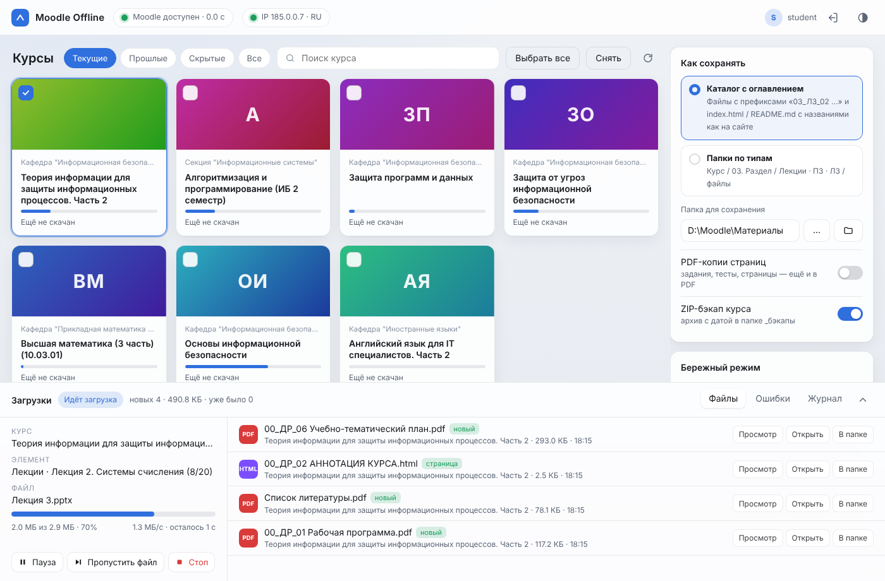

# Moodle Offline — all your Moodle course materials on your own computer

🇷🇺 [Русский](README.md) · 🇬🇧 **English**

> **About this page.** This is the English guide to the program. The project's full reference is the [Russian README](README.md) (about 1,400 lines, with every setting and every internal detail). This page covers everything a user needs; where the Russian text goes deeper, it is marked like this: **(RU §4б)** = section 4б of the Russian README. The history of changes is in [CHANGELOG.en.md](CHANGELOG.en.md).
>
> **The program's interface is in Russian.** Button and tab names below are given in Russian in quotes, with an English gloss.

Moodle Offline is a local program for students of **Sevastopol State University (SevSU, Russia)**. It signs in to your own Moodle account (by default `do.sevsu.ru`), saves the materials of the courses you choose so you can work without internet, and adds a schedule, notifications, search and notes on top. It runs on **Windows, Linux, macOS and Android**, entirely on your own device: there is no server, no account with us, and nothing is sent anywhere unless you press a button that says so.

> **Scope, honestly.** The Moodle address is editable, but the program was built and tested only against SevSU's Moodle (3.x). The schedule, Excel timetable and sports-electives features are specific to SevSU's sites (`schedule.sevsu.ru`, `timetable.sevsu.ru`, `iot.sevsu.ru`). On another Moodle the basic download may work, but it has not been tested, and Moodle 4.x pages have not been checked.



---

## Contents

1. [What it does](#1-what-it-does)
2. [Install and first run](#2-install-and-first-run)
3. [How files are organised](#3-how-files-are-organised)
4. [Interruptions, offline and being kind to the server](#4-interruptions-offline-and-being-kind-to-the-server)
5. [The tabs, one by one](#5-the-tabs-one-by-one)
6. [Settings, updates and where your data lives](#6-settings-updates-and-where-your-data-lives)
7. [VPN and the IP check](#7-vpn-and-the-ip-check)
8. [Console version](#8-console-version)
9. [Troubleshooting](#9-troubleshooting)
10. [Privacy and security](#10-privacy-and-security)
11. [Project layout, tests and building](#11-project-layout-tests-and-building)
12. [What was verified and what was not](#12-what-was-verified-and-what-was-not)

---

## 1. What it does

**It saves:**

- **files** — lectures, handouts, report templates, presentations;
- **folders** — with their nested structure;
- **assignments** (practical and lab work) — the task text and attached files;
- **pages and books**;
- **quizzes** — the description and your finished attempts;
- **IMS/SCORM lecture packages** — with all pictures and a local table of contents;
- **text blocks** and **links**;
- **attendance** tables and a **grades** summary (read from the site).

Everything is sorted by course, section and kind of class (Lectures / Practicals / Labs), with a table of contents that uses the names exactly as on the site.

**On top of that:**

- **A course view “as on the site”** right in the window: assignments, pages, forums, quizzes and folders open here, with completion marks and access restrictions shown.
- **Schedule** of your group for any period, offline, with an `.ics` file for your calendar; the university's semester Excel files are read automatically; **other groups' schedules** (a friend's, a classmate's) can be downloaded, switched between, and shared as a file.
- **Sports electives** (physical education): what you picked and what you can pick, “main choice + reserves by priority”, signing up for classes, and notifications.
- **“Что нового” (What's new):** a feed of changes per course (new materials, teacher announcements, grades) with notifications to Windows, Telegram or your own webhook.
- **Search** inside everything you downloaded (lecture text, slides, spreadsheets, file names) — offline.
- **Calendar and deadlines:** assignment and quiz deadlines from Moodle together with classes, in one agenda, one `.ics` file, with reminders.
- **Notes:** a general notebook and per-class notes inside the course window; they are plain `.md` files.
- **AI on your own key** (optional): ask a question about your materials, summarise a file, make practice questions. Nothing is sent until you enter a key and give consent.
- **Access for external AI tools** (optional, off by default): Claude Code, Cursor, VS Code and others can read your materials over MCP — read-only, this computer only, with a token.
- **File reserve:** if a teacher replaces a lecture with a “stub” (a tiny file), the previous version is kept.
- **Timer and auto-update:** check whether Moodle is alive and, if you switch it on, quietly download whatever is missing.
- **Data transfer between devices:** computer → phone over Wi-Fi (QR code) or as one `.zip`, with no login and no password.
- **“Вид” (View):** every section has a settings sheet — style, sorting, density, what to show; tabs can be reordered and hidden.
- **Update check** for the program itself, with a one-button update on Windows `.exe` and Linux.

---

## 2. Install and first run

Download the file for your system from the latest release: **<https://github.com/JINXPIL/Moodle-Offline/releases/latest>**

| System | File | Notes |
|---|---|---|
| Windows 10/11 | `MoodleOffline.exe` | one portable file, no Python needed; a `.sha256` checksum lies next to it |
| Android (any phone) | `MoodleOffline.apk` | **universal — take this one if unsure**; Python 3.11 inside |
| Android, modern 64-bit | `MoodleOffline-arm64-v8a.apk` | smaller; almost every phone since 2017 |
| Android, old 32-bit | `MoodleOffline-armeabi-v7a.apk` | |
| Android emulators / ChromeOS | `MoodleOffline-x86_64.apk` | |
| Linux (x86-64) | `MoodleOffline-linux-x86_64` | one executable; needs glibc 2.35+ (Ubuntu 22.04, Debian 12, Fedora 36 or newer) |
| Mac, Apple Silicon | `MoodleOffline-macos-arm64.zip` | contains `MoodleOffline.app` |
| Mac, Intel | `MoodleOffline-macos-x86_64.zip` | |

Some antivirus programs flag any PyInstaller `.exe`. This is a false positive; you can verify the SHA-256 checksum, or build the file yourself from the source (section 11).

### Windows

1. Put `MoodleOffline.exe` in a folder with a short path (for example `D:\Moodle`), not deep inside “Downloads”: some Moodle file names are very long.
2. Double-click it. If Windows shows the blue SmartScreen window, press “More info” → “Run anyway”.
3. Your login, settings and course list are kept in your user folder (`%LOCALAPPDATA%\MoodleOffline`), so **a new version can be placed anywhere** and nothing is lost. Putting an empty `portable.txt` next to the program keeps everything beside it instead (USB-stick mode). **(RU §7, §7а)**

Running from source on Windows: install Python 3.11+ (tick “Add python.exe to PATH”), unpack the project, double-click `Запустить.bat`. The first run installs the libraries once (internet needed).

### Android

1. On the phone, open the Releases page and download the `.apk` (or any variant from the table).
2. Open it. Android will ask for permission to “install from unknown sources” for your browser or Files app — allow it for this one install.
3. Start **Moodle Offline** and allow notifications (they power “What's new”, deadlines and “Moodle is down” messages).
4. Sign in the same way as on a computer.

Notes: materials are stored first in the app's own storage; the settings offer a button for access to “Documents” if you want them visible in the Files app. The folder button opens the system Files app. While running, the app keeps a notification (“Moodle Offline работает”) — that is what lets Android allow background checks. The password is **not** saved on the phone, only the Moodle session. **(RU §7б)** There is also a **Termux** variant for people who prefer it (`install_termux.sh`).

### Linux

```
chmod +x MoodleOffline-linux-x86_64
./MoodleOffline-linux-x86_64
```

A Chrome, Chromium, Edge or Brave browser makes the program open as its own window; without one (or with a snap Chromium) it opens a browser tab. `zenity` or `kdialog` give you a folder picker, `notify-send` gives pop-up notifications, systemd gives the nightly sync timer — all optional. Update with the “Обновить сейчас” button. **(RU §7г)**

### macOS

Unpack the archive, drag `MoodleOffline.app` to Applications. The app is **not signed** with an Apple developer certificate, so the first launch is blocked: open “System Settings → Privacy & Security → Open Anyway”, or run `xattr -dr com.apple.quarantine /Applications/MoodleOffline.app`. Updating is manual (download, replace the app; your data is stored separately). **(RU §7г)**

### Signing in

Open the program, check the address (`https://do.sevsu.ru` is pre-filled), enter your Moodle login and password, and leave “Запомнить меня” (remember me) ticked. On Windows the saved login is encrypted with DPAPI (only your Windows account can decrypt it); on Linux, macOS and Android only the session cookie is saved, never the password.

If your login goes through a single sign-on page, the program follows it. Two-factor authentication, captchas and logging in through Gosuslugi cannot be automated — use **“Вход по cookie (SSO)”** (sign in by cookie): sign in in your browser, copy the `MoodleSession` cookie from the developer tools, and paste it into the program. **(RU §9)**

### First download

1. On the “Курсы” (Courses) tab, tick the courses you want (filters: current / past / hidden / all).
2. In “Настройки” (the gear icon in the header) choose the layout and the folder.
3. Press **“Скачать выбранные”** (download selected). A downloads manager shows the file, percentage, speed and time left, with pause / skip file / stop.
4. You can close the window; the download finishes in the background.

Tip: before a big first download, run the console version and choose “3 — Проверка” (dry run): it shows what the program found in each course and how it classified it, without downloading anything.

---

## 3. How files are organised

Three ways to lay out the same course (choose in “Настройки”): **(RU §2)**

- **Mode 1 — one folder per course with a table of contents.** All files of a course in one folder with prefixes such as `01_ЛК_02 …` (section 01, lecture, second item), plus `index.html` and `README.md` listing everything with the names exactly as on the site. A root `index.html` lists all courses.
- **Mode 2 — folders by type.** `Course / 01. Section / Лекции | ПЗ | ЛЗ | Прочее / files` (lectures / practicals / labs / other).
- **Mode 3 — your own template.** Build folder and file names from fields such as `{section_no}`, `{section}`, `{kind}`, `{kind_code}`, `{seq}`, `{item}`, `{type}`, with a live preview. Console: `--dir-template`, `--file-template`.

If you change the layout and press the quick sync, files are copied locally into the new layout, not downloaded again.

How the kind of class is decided: first from the item's name (“Лекция…”, “ЛР”, “Практическая…”), then from the nearest heading in the section, then from the section's name; everything else goes to “Прочее” (other). Forums, webinars and other items without materials are not downloaded (the table of contents has an “open on the site” link) — except **attendance**, whose table is saved.

**Service files** in the save folder **(RU §3)**: `_не_скачано.txt` (what could not be downloaded, with reasons), `_новое.txt` (what is new since the last run), `_пропущено_правилами.txt` (what your rules skipped — not errors), `_журнал.log` (log), `Календарь/` (calendar `.ics` and offline page), `Заметки/` (your notes), `<Course>/Объявления/` (announcements), `<Course>/_Резерв/` (previous file versions), `_бэкапы/` (optional ZIP backups), and hidden `.moodle_*.json` / `.moodle_search.sqlite` files with the program's memory, the news feed, grades, deadlines and the search index. Don't delete `.moodle_state.json`: it is what makes quick resume possible.

---

## 4. Interruptions, offline and being kind to the server

Just start the program again; it continues by itself. **(RU §4)**

- **An unfinished file** is kept as `name.tmp` and resumed from where it broke off (if the server supports it). A finished file is renamed only after its size (and checksum, when the server gives one) is verified, so a completed file is never “half-broken”.
- **Files already downloaded** are never downloaded again.
- **Server error 502/504 or lost network:** the program waits and checks the site every 30–60 seconds, up to 4 hours (configurable), then carries on.
- **Server overloaded (429/503):** it sleeps 1, 2, 4, 8, 10 minutes and respects `Retry-After`.
- **Session expired** (8 hours on do.sevsu.ru): it signs in once more and continues, but never re-tries logins quickly, so it can't look like password guessing.
- **Quick sync** (“Синхронизация”) skips what is already processed and re-checks only folders; good for a weekly top-up. Replaced files inside an already downloaded item are noticed only by a full download.

**Being kind to the university's server:** one request at a time, human-like pauses, “sleep” on overload, one login for the whole job. There is no parallel downloading, and there will not be. “Бережный режим” (gentle mode) and quiet hours let you restrict when the program works.

**Offline mode.** If Moodle is unreachable, the program starts anyway, shows everything saved (courses, search, notes, schedule, calendar, the reader's saved copies) and tells you it is offline. **(RU §4г)**

---

## 5. The tabs, one by one

### Courses and the course window  **(RU §4а)**

Click a course card to see its sections and items with the Lecture/Practical/Lab labels, search and a filter by kind. Each downloaded file has “Просмотр” (preview: PDF, pages and pictures open in the window), “Открыть” (open in Word, PowerPoint…) and “В папке” (show in folder). Next to each item the program shows the site's own marks — “✓ done on the site”, “not done”, “not passed” and the reason an item is locked — as a snapshot from the last update. It also saves **attendance** (classes, status, points, percentage) and a **grades** summary (one extra request per update; can be switched off).

**“Открыть здесь” (open here) reader:** any item opens inside the program as cleaned-up, read-only text — task description and deadline, submission status, forum discussions, tables, pictures. Actions (submit, reply, start a quiz) stay on the site (“На сайте” opens your browser). What you opened is saved and readable offline; if the site is down you get the saved copy immediately instead of a long wait.

Course card titles and categories are shown in full (no ellipsis), including with the picture hidden on a phone.

### Что нового (What's new) — feed and notifications  **(RU §3б)**

After each download or sync the program compares each course with last time and writes events: new materials and files, **teacher announcements** (saved with attachments into `<Course>/Объявления/`), new/changed grades and comments, things removed from the site, replaced files. Channels: a Windows pop-up, Telegram bot, or a webhook (plain JSON, Discord, Slack, ntfy), with per-event and per-course choices and a “test sending” button. The first check of a course reports nothing and only memorises.

### Поиск (Search)  **(RU §3в)**

Full-text search inside downloaded PDF, Word, PowerPoint, Excel, OpenDocument, HTML and text files, plus file names — offline and without logging in. It understands word forms, `"exact phrases"` and `-exclusions`; results show up to three highlighted snippets and PDFs open at the right page. Filters by course and type. The index (`.moodle_search.sqlite`) is only a cache and can be deleted. “Что не прочиталось” lists files it could not read (scans, old `.doc`, password-protected, too big).

### Календарь (Calendar and deadlines)  **(RU §3г)**

Deadlines of assignments and quizzes from the Moodle calendar plus your timetable classes in one agenda (overdue → today → tomorrow → later), with a “done” mark. `Календарь/moodle_calendar.ics` works in Google, Apple and Outlook calendars (reminders a day and 3 hours before deadlines, 15 minutes before classes), and there's an offline page. Notifications: new deadline, deadline moved, deadline burning. Attendance entries are classes, not deadlines, and are a separate, off-by-default kind.

### Заметки (Notes)  **(RU §3д)**

A general notebook and per-class notes (a “Заметка” button on each item). Notes are ordinary `.md` files in `Заметки/`, editable with any editor; autosave, pinning, select-many and bulk delete with “Вернуть” (undo; trash keeps the last 50). They are indexed by search and travel with data transfer.

### Расписание (Schedule)  **(RU §4б)**

Your group's timetable for offline use, from `schedule.sevsu.ru` and/or your personal `timetable.sevsu.ru`, and from the university's semester **Excel** files (found automatically, or pick/paste/upload one). Views: day / week / month / list, swipe, text size; an `.ics` export. **Excel files keep up with the site:** each save compares the downloaded table with the saved one (“file unchanged” / “file updated: N classes added, M removed”, plus an entry in “Что нового”); a new file replaces the saved one only after your group is found in it, and **if the university site is down, returns an error, was redesigned, or sends junk instead of a file, the app stays on the saved file** and says so in the window. The real page links to the tables as `download.php?file=…` (no “.xlsx”), which the program recognises by the file icon and remembers by headings (year → kind of schedule → institute → semester). (RU §4б) You choose how far ahead to update (2 weeks / month / end of semester) and the window tells you how far the site has published. **Your own group** comes from your settings — the program never assumes anyone's group by default. **Other groups:** add any group (no login needed), switch between them from the list above the schedule, optionally update them together with yours, and **share** selected schedules as one `.zip` (contains an `index.html` that opens without the program, an `.ics` and the data — no passwords or settings); the recipient can import it.

### Успеваемость (Academic record)  **(RU §4в-1)**

Your electronic record from the lk.sevsu.ru personal account (“Сведения об успеваемости”): every semester of the study plan with subject, type of assessment, grade, credits (ZET), hours and date. Press “Обновить с сайта” to sign in with your SevSU login (the password is sent only to https pages on `sevsu.ru`) and save it, or use “Из файла…” with the page saved from your browser (Ctrl+S, “Web page, HTML only”) if signing in fails. The tab opens with a summary card — the average grade (grades 5–2; plain pass/fail credits are not counted — it may differ from the official figure), how many subjects are passed, how many credits are earned, and how many 5s, 4s and 3s you have. Below it: a strip of semesters (“passed N of M”), a filter “Все / С оценкой / Ждут” (all / graded / waiting) and a magnifier for searching subjects across all semesters. Subjects are cards rather than a table (1.31.0): a coloured edge by grade, a round grade badge on the right, a dashed card for a subject that is still waiting; long names wrap instead of scrolling sideways. On a phone the semester strip stays under the header while you scroll and the tab label is the shorter “Оценки”. The update buttons and the password box sit in a collapsed block “Обновление и вход” under the list (it opens by itself when there is no data yet or a sign-in is needed). A new or corrected grade adds an entry to “Что нового”; the grade itself is not sent to Telegram/webhook by default. The data lives in `Успеваемость/` (JSON plus a page that opens offline), is not transferred to other devices, is not searchable and is hidden from external AI tools. If the site is down, what was saved stays. Tested on made-up pages with the real markup and on a mock login; the real sign-in to lk.sevsu.ru has not been verified.

### Элективы (Sports electives)  **(RU §4в)**

Through the `iot.sevsu.ru` API (works on a phone too): selection blocks with status, options with free places, your choice, the allocation result and upcoming classes. Since 1.32.0 the tab is laid out for a phone: “Обновить” sits in the tab header, login and watching live in a collapsible “Вход и слежение” panel, section chips (“Выбор / Занятия / Мои блоки”) stick under the header, options are tiles in two columns that you tap to choose (a role list at the bottom of the tile when a block needs several picks), big blocks get a filter and search, a save bar stays above the bottom tabs, upcoming classes are grouped by day with a filter, and past blocks collapse to one line. “Вид” can hide full options and descriptions. Choose “main + reserves by priority”, review the summary, then press “Сохранить на сайте”; signing up for a class and cancelling are also two taps. Nothing is saved or signed up unless you press the button, and the program shows the site's own answer as is. The watcher can notify you about new blocks, an open selection, the allocation and new classes. This part has been tested only against a mock of the site (the real login is closed to automated tests); the new layout was checked in Chromium on made-up data, not on a real phone. Since 1.32.1 every action against the site (refresh, save, sign up, withdraw) uses short time-outs and fails fast with a clear message when the site does not answer, instead of waiting for it to come back; a strip “Связываюсь с сайтом…” with a “Отмена” (cancel) button shows under the header while it works, and after a cancel or a failure the program says whether the request may have reached the site (if so: press “Обновить” and check). A failure of the electives site no longer turns the header to “Moodle недоступен”. The site's option, class and sign-up numbers are kept as the strings the site gives (turning them into numbers made picks invisible and the summary read “NaN”).

### Нейросеть (AI inside the program)  **(RU §3е)**

Ask a question about your own materials (answer with links to the source files), summarise a file, or generate practice questions. It works with **your own key** for Google Gemini, Claude (Anthropic), OpenAI, or “your own address” in the OpenAI format (OpenRouter, Ollama, LM Studio); there is no AI built in. **Nothing is sent** until you pick a service, enter a key and give consent, and then only when you press a button; the amount of text sent is capped. Keys are stored apart from the settings (encrypted on Windows) and never transferred. Proxy: the system proxy is used by default (Happ, Clash Verge in “system proxy” mode, TUN works transparently); a plain-HTTP proxy can be set; SOCKS is not supported (use the same client's HTTP port). The window shows how requests will go before you send anything.

### Доступ для нейросетей (External AI tools via MCP)  **(RU §3ж)**

Off by default. When enabled, programs such as Claude Code, Cursor or VS Code can **search and read** your downloaded materials (and, with a separate tick, your notes) through a local MCP server. Read-only (no write tools exist), `127.0.0.1` only, bearer token, request log without text. The program itself sends nothing anywhere.

### Файл-резерв (File reserve)  **(RU §4е)**

Teachers sometimes replace a lecture with a tiny “stub” PDF; Moodle then changes the file's address and the old file used to be overwritten. Now the previous version is moved to `<Course>/_Резерв/` (3 versions kept), a file that is 5× smaller (from 20 KB) or empty is flagged “looks like a stub”, and a “Файл заменён” event appears in “What's new”. On by default; console `--no-reserve`.

### Загрузки (Downloads), Перенос данных (Data transfer), Таймер (Timer)

- **Downloads** **(RU §4а-1)**: overall bar to 100 %, speed, time left, files grouped by course; on a phone it's an icon in the header with a full-screen sheet.
- **Data transfer** **(RU §4д)**: “Настройки → Дополнительно → Перенос данных”. Computer → phone over Wi-Fi (QR code + address; only what is new; resumes) or as a `.zip`. You choose what to move. **Never transferred:** password, login and cookies, Telegram token, webhook address, AI keys, MCP token, paths, proxy. Wi-Fi sharing works only on a private network, with a code, for 15 minutes, and is not encrypted.
- **Timer and auto-update** **(RU §5а)**: a “is Moodle alive” check (30 s – 3 h, days and hours of your choice) with “Moodle не отвечает / снова работает” messages, and an optional switch (off by default) that compares disk with the program's memory and downloads only what is missing. Windows autostart and a nightly sync are available; on Linux/macOS they use systemd and LaunchAgents.

### Вид (View), Настройки (Settings)  **(RU §4а-2 … §4а-5)**

Every section has a “Вид” button: a sheet of “item — choice” rows (cards or list, sorting, density, picture, grouping, what to show…). Tabs can be reordered and hidden (“Курсы” cannot). Settings are behind the gear icon in the header. **Your interface settings now survive restarts and updates**, and “Сброс” (reset) offers “Сбросить вид” (reset view) and “Сбросить всё” (reset everything; login, folder, courses, group, AI settings and autostart are kept, and a copy of the old settings is saved).

---

## 6. Settings, updates and where your data lives

**Updating.** “Настройки → Обновление программы” has “Проверить сейчас”, an automatic daily check (on by default; period 6 hours – a week), “Пропустить эту версию” and a notice when a new version appears. The check sends one request to `api.github.com` and nothing personal. On Windows `.exe` and Linux, “Обновить сейчас” downloads the release file, verifies SHA-256, size and file type, and swaps itself in; macOS and Android update by hand. If the program is started a second time, the new copy asks the old one to close and takes its place. **(RU §7в)**

**Old program versions.** “Настройки → Старые версии программы” finds earlier downloaded files of the program itself — `.exe`, `.apk`, archives, `.sha256` files and update leftovers (`.old`, `.new`, unfinished downloads) — in Downloads, on the desktop, in Documents and next to the program (on a phone: shared storage, which needs “all files” access). Each file has a checkbox, with “Выбрать все” / “Снять все” and “Удалить выбранные”; deletion asks first and is permanent. Old versions and leftovers are ticked for you; newer, identical and unrecognised files are not. The version comes from the file name (for an `.apk`, from the file itself); the running program is never listed, only regular files are deleted, and only ones a fresh search just showed. **(RU §7в-1)**

**Notices in the window** can be closed with the cross, swiped sideways on a touch screen, or all at once with “Закрыть все”; they stay while the pointer or a finger is on them, and no more than five are stacked. **(RU §7в-2)**

**Where data lives** **(RU §7а, §7г)**:

| System | Data (login, settings, keys) |
|---|---|
| Windows | `%LOCALAPPDATA%\MoodleOffline` (or beside the exe with `portable.txt`) |
| macOS | `~/Library/Application Support/MoodleOffline` |
| Linux | `~/.local/share/moodle-offline` (or `$XDG_DATA_HOME/moodle-offline`) |
| Android | the app's own storage |

Materials go to the folder you choose (default: “Материалы Moodle” next to the program or in Documents). A new version finds the previous version's data by itself and copies it (“Перенос из старой версии…”, console `--import-data`). Prefer a save folder **outside OneDrive**: OneDrive locks fresh files and can turn them into “cloud-only” ones that won't open offline.

---

## 7. VPN and the IP check

SevSU's Moodle blocks foreign IP addresses, so before work the program checks the country of your external IP; if it is not Russia, it warns you and won't start a download without confirmation (a nightly run simply does not start and notifies you). By default the program goes to Moodle **directly, bypassing the system proxy**. In VPN “TUN” mode, either switch the VPN off or put `do.sevsu.ru` on the `DIRECT` list. If you do need a proxy, tick “Через системный прокси”. With split routing (DIRECT for SevSU) the IP-check services may still see the VPN address — use the “Скрыть: у меня DIRECT для СевГУ” button. **(RU §6)**

---

## 8. Console version

`Консольная версия.bat` (or `./run.sh --cli`) shows a menu: download / quick sync / structure check / forget login. Pick courses by number, e.g. `1, 3, 5-7`. For automation: `python moodle_offline.py --help`. **(RU §8)**

| Option | What it does |
|---|---|
| `--mode 1` / `--mode 2` | layout mode |
| `--dir-template` / `--file-template` | your own template (turns on mode 3) |
| `--courses 3594,3576` / `--all` | course IDs (from `course/view.php?id=…`) / all courses |
| `--out PATH` | save folder |
| `--sync` | quick sync with the saved settings |
| `--dry-run` | show the structure only, download nothing |
| `--pdf` / `--zip` | PDF copies of pages / ZIP backup of a course |
| `--no-reserve` | don't keep previous versions of replaced files |
| `--no-news`, `--no-grades`, `--no-calendar`, `--no-search-index` | skip that step in this run |
| `--search "query"` | search downloaded materials (no login needed); `--search-index` / `--search-reindex` |
| `--news-list` / `--news-read` | show unread “What's new” / mark all read |
| `--deadlines [DAYS]` | show deadlines and classes (no login or internet) |
| `--calendar-sync` | update only the Moodle calendar |
| `--schedule … --group … [--other]` | download a schedule |
| `--watch`, `--watch-status`, `--auto-update` | timer without a window / its status / one auto-update pass |
| `--hours 01:00-07:00` | quiet hours |
| `--wait-server` | wait for Moodle to come up, then start |
| `--cookie "MoodleSession=…"` | sign in with a cookie from the browser |
| `--forget` | forget the saved login |
| `--import-data FOLDER`, `--data-info` | import the previous version's data / show where data lives |
| `--mcp` | MCP server over stdio for external AI tools |

On Linux and macOS from source: `./run.sh` (window), `./run.sh --cli` (console), `./run.sh --sync` (for cron). Android (Termux): `moodle-offline` / `moodle-offline --cli`; the `.apk` has no console.

---

## 9. Troubleshooting

More detail in the Russian README: **(RU §9)**.

- **“Нет связи с программой” / “Программа ответила ошибкой” at the top of the window.** The program is closed (start it again) or hit an internal error (use “Перезапустить программу”). It no longer quits under a live window; failures are written to `errors.log` in the data folder, without passwords or keys. If it keeps happening, send `errors.log` and say what you were doing.
- **“Неверный логин или пароль”.** Moodle shows it both for a wrong password and when the login form fails. Check that the same credentials work in your browser; don't try many times in a row (Moodle may block you temporarily, with the same message); the program saves a diagnostic without the password in `login_debug.txt`. Always-working workaround: **sign in by cookie** (see “Signing in”).
- **Certificate error.** Usually solved by `truststore` (on by default): the program uses the system's certificates, like a browser.
- **A course opens but items are not found.** Run `--dry-run --save-html`; the saved pages in `_debug` have the session key replaced by `REDACTED` and show what the selectors missed. **(RU §10)**
- **PDF copies not created.** They need Microsoft Edge or Google Chrome on a desktop (not on a phone). Set `MOODLE_BROWSER=path\to\msedge.exe` in `.env` if it is in an unusual place.
- **Search doesn't find something you downloaded.** “Поиск → Настройки поиска → Что не прочиталось” shows unreadable files; “Пересобрать с нуля” rebuilds the index. When running from source install `pypdfium2` (or `pypdf`) for PDFs.
- **“Path too long” on Windows.** Move the program and the save folder closer to the drive root (`D:\Moodle`).
- **A lecture package is blank in “Просмотр”.** Fixed in 1.14.0; pages that need the internet (online services, YouTube) won't work offline, of course.

---

## 10. Privacy and security

More detail in the Russian README: **(RU §11)**.

- **Everything stays on your device.** There is no server of ours. The program talks to your Moodle and the university's sites, and — only if you turned them on — to your notification channel (Telegram/webhook), your AI service, or GitHub for the update check.
- **The password is never in the code.** With “remember me” on Windows, login and cookies are encrypted with DPAPI. On Linux, macOS and Android only the session cookie is stored (file permissions 600). Keys and tokens (AI keys, MCP token, Telegram token) live in separate `*.bin` files, not in the settings, never in logs and never in data transfer.
- **The program window is local-only:** `127.0.0.1` with a random access key; it answers only its own window, so other websites in your browser can't drive it.
- **Files from courses are treated as untrusted.** `.html` and `.svg` attachments open in a sandbox without access to the program; `.exe`, `.bat`, `.ps1`, `.lnk`, `.jar` and similar are never launched by the program (only “show in folder”).
- **Your files survive crashes:** settings, state and keys are written through a temporary file and flushed to disk; `settings.json` has a backup copy; a file briefly locked by antivirus or OneDrive is re-read instead of being treated as damaged.
- **Don't hand the data folder to others** (it holds your login). The search index and calendar contain your course text and names — don't attach them when sharing a folder.
- **AI and MCP are opt-in.** Nothing is sent to an AI service without a key, consent and a button press; the MCP server is off until you enable it, listens only on `127.0.0.1`, and is read-only.

---

## 11. Project layout, tests and building

The code is plain Python plus one HTML/JS file for the window (`ui/index.html`); a PyInstaller build makes the `.exe`/Linux/macOS binaries, and a Gradle project (Chaquopy) makes the `.apk`. Third-party libraries are kept to a minimum (`requirements.txt`).

| Part | Role |
|---|---|
| `moodle_offline.py` | core: login, Moodle client, download, resume, ZIP backup, console version, `VERSION` |
| `gui.py`, `ui/index.html` | local web interface and its API |
| `schedule.py`, `sch_book.py`, `xlsx_schedule.py` | schedule, other groups, Excel timetable reader |
| `lk.py` | “Успеваемость”: lk.sevsu.ru record parser, figures, comparison, storage, sign-in |
| `iotapi.py`, `electives.py` | electives (API, and a fallback through a background browser) |
| `news.py`, `deadlines.py`, `notes.py`, `search.py`, `reserve.py`, `reader.py` | feed, calendar, notes, search, file reserve, reader |
| `ai.py`, `mcp_server.py` | AI window and the read-only MCP server |
| `transfer.py`, `qr.py`, `uistate.py`, `datadir.py` | data transfer, QR codes, saved window settings, data location |
| `updater.py`, `oldver.py`, `watch.py`, `desktop.py`, `android.py`, `apk_main.py`, `android-app/` | updates, old program versions, timer, Linux/macOS, Android |

(Full table: RU §12.) Everything is described for contributors in `CLAUDE.md` (in Russian).

**Tests.** `python tests/run_all.py` (Python 3.11 and 3.13; details in `tests/README.md`) runs every `tests/test_*.py` against mock sites (`mock_moodle.py`, `mock_iot.py`) — no real site is needed. GitHub Actions runs them on every pull request.

**Building.** Windows: `Собрать EXE.bat` (or the `build-exe` workflow). Releases are built by GitHub Actions when a `v*` tag is pushed: `.exe`, four `.apk` files (with an emulator check), Linux and two macOS archives. **(RU §7, §7б, §7г)**

**Rules for contributions:** requests to the server are sequential with pauses; no secrets in commits or logs; a bug gets a test first, then the fix; user-visible changes update the READMEs and the changelog; pull requests go to `main`.

Licence: [MIT](LICENSE).

---

## 12. What was verified and what was not

The university's sites require a login, so they cannot be tested automatically. The program was developed against saved pages sent by its author, against mock copies of the sites, in Chromium (phone and desktop widths), in an Android emulator, and on GitHub's Linux and macOS servers (builds start and quit correctly; the whole test suite passes on macOS).

**Not verified:** the real electives login and sign-up, the real Excel-timetable page, Moodle 4.x pages, a real Android phone (WebView), Windows with Edge in app-window mode, real Linux and Mac desktops (folder dialogs, notifications, autostart, Gatekeeper), real Gemini/Claude/OpenAI keys and real MCP clients, the “all files” folder listing for old program versions on a real phone and deleting a file that another program holds open on Windows. Per-version details are in the [changelog](CHANGELOG.en.md) and in each pull request's “not verified” section. If something works differently for you, please [open an issue](https://github.com/JINXPIL/Moodle-Offline/issues) and attach `errors.log` (it contains no secrets).
