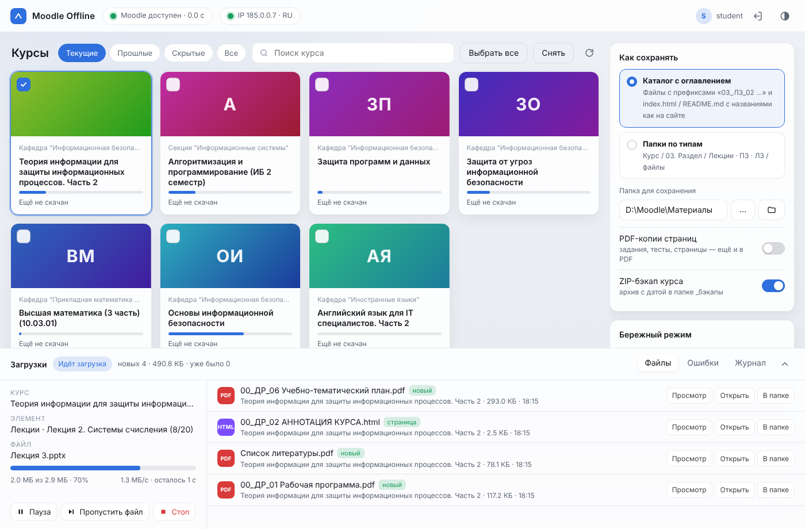

# Moodle Offline — все материалы курсов Moodle на вашем компьютере

Программа входит в ваш личный кабинет Moodle (по умолчанию — `do.sevsu.ru`) и сохраняет учебные материалы выбранных курсов для работы без интернета:

- **файлы** — лекции, методички, шаблоны отчётов, презентации;
- **папки** — с сохранением вложенной структуры;
- **задания ПЗ/ЛЗ** — текст задания и прикреплённые файлы;
- **страницы и книги**;
- **тесты** — описание и просмотр ваших завершённых попыток;
- **пакеты лекций IMS/SCORM** — со всеми картинками и локальным оглавлением;
- **текстовые блоки** и **ссылки**.

Ещё в программе есть:

- **просмотр курса «как на сайте»** прямо в окне: задания, страницы, форумы, тесты и папки открываются здесь же, без перехода на сайт;
- **расписание группы** на любой период для офлайна, с файлом `.ics` для календаря; Excel-таблицы университета на весь семестр читаются сами; **расписания других групп** (друга, одногруппника): скачать с сайта, переключаться между ними и отправить файлом (раздел 4б);
- **элективы СевГУ**: что выбрано и что можно выбрать, выбор «основной вариант + резервы по приоритету», запись на занятия и уведомления об изменениях;
- **«Что нового»**: лента изменений по курсам (новые материалы, объявления, оценки) и уведомления в Windows, Telegram или на свой webhook.
- **поиск по материалам**: слова из лекций, презентаций, таблиц и названия файлов — всё, что скачано, находится без интернета;
- **заметки**: общий блокнот и заметки к занятиям прямо в окне курса; это обычные файлы `.md` в папке «Заметки», они находятся поиском и переносятся на телефон;
- **«Вид» — настройка под себя**: у каждого раздела (курсы, окно курса, расписание, заметки, поиск, календарь, «Что нового», элективы) есть кнопка с ползунками — стиль, сортировка, плотность, что показывать и какие кнопки оставить; можно поменять местами и скрыть вкладки;
- **нейросеть по вашему ключу**: вопрос по своим материалам с ссылками на источники, краткий пересказ файла, вопросы для подготовки к зачёту; Gemini, Claude, ChatGPT или свой адрес. Пока вы сами не введёте ключ и не дадите согласие, ничего никуда не отправляется (раздел 3е);
- **доступ для внешних нейросетей**: Claude Code, Cursor, VS Code и другие программы подключаются к вашим материалам (и, если разрешите, заметкам) по MCP — только чтение, только на этом устройстве, по токену; по умолчанию выключено;
- **календарь и дедлайны**: сроки сдачи заданий и тестов из Moodle вместе с парами расписания — в одной повестке, в одном `.ics` для телефона и с напоминаниями.
- **таймер и автообновление**: вы сами выбираете, как часто проверять, жив ли Moodle (и получать сообщение, когда он упал или ожил), и можно включить «рубильник» — программа сама по таймеру сверит файлы на диске и докачает недостающее по всем или выбранным курсам.
- **перенос данных между устройствами**: скачали на компьютере — одним нажатием перенесли на телефон (по Wi-Fi с QR-кодом или одним файлом `.zip`), без аккаунта и без пароля (раздел 4д).
- **Android**: то же самое на телефоне — готовое приложение `.apk` (скачали, поставили, пользуетесь) или запуск в Termux (раздел 7б).
- **проверка обновлений программы**: в «Настройках» — кнопка «Проверить сейчас» и рубильник «Проверять само»; о новой версии скажет плашка и уведомление (раздел 7в).

Всё раскладывается по курсам, разделам и типам занятий (Лекции / ПЗ / ЛЗ), с оглавлением, где названия указаны ровно как на сайте.



Главное:

- **Работает при нестабильном сервере и отключениях света.** Файл сначала качается как `имя.tmp` и переименовывается только при 100 %. Повторный запуск продолжает с места обрыва и не качает заново то, что уже есть.
- При ошибке **502** или пропаже сети программа не падает, а ждёт, проверяя сайт каждые 30–60 секунд, и продолжает сама.
- **Бережна к серверу вуза:** один поток, паузы как у человека, «сон» при перегрузке сервера, один вход на всю работу.
- Есть **графический интерфейс** (светлая и тёмная тема), **консольная версия** и **готовые программы**: `.exe` для Windows, приложение для macOS и один файл для Linux (раздел 7г).

---

## 1. Быстрый старт (Windows, без опыта)

> **Linux и macOS** — в разделе 7г («Linux и macOS»): там готовые файлы для скачивания и первый запуск.

**Шаг 1. Установите Python** (если уже есть, пропустите шаг).
Откройте <https://www.python.org/downloads/>, нажмите «Download Python 3.x», запустите установщик и
**обязательно поставьте галочку «Add python.exe to PATH»** внизу первого окна. Затем нажмите «Install Now».

**Шаг 2. Распакуйте архив** в папку с коротким путём, например `D:\Moodle`. В Windows лучше не класть программу
глубоко в «Загрузки» или на «Рабочий стол»: у некоторых файлов в Moodle очень длинные названия.

**Шаг 3. Запустите двойным кликом файл `Запустить.bat`.**
В первый раз программа примерно минуту готовит окружение и ставит библиотеки (нужен интернет). Это делается один раз.
Потом откроется окно программы. Если Windows покажет синее окно SmartScreen, нажмите «Подробнее» → «Выполнить в любом случае».

**Шаг 4. Войдите.** Адрес уже подставлен (`https://do.sevsu.ru`). Введите логин и пароль от Moodle.
Оставьте включённым «Запомнить меня», тогда в следующий раз пароль спрашиваться не будет.

**Шаг 5. Выберите курсы.** Нажмите на карточки нужных курсов (появится галочка). Фильтры сверху: «Текущие», «Прошлые», «Скрытые», «Все».
Справа выберите способ раскладки и папку, затем нажмите **«Скачать выбранные»**.

**Шаг 6. Ждите или занимайтесь своими делами.** Внизу виден менеджер загрузок: какой файл качается, сколько процентов,
скорость и сколько осталось. Там же кнопки «Пауза», «Пропустить файл» и «Стоп».
Окно можно закрыть, загрузка завершится в фоне. По окончании прозвучит сигнал и появится уведомление Windows.

> Совет: перед первой большой загрузкой запустите `Консольная версия.bat` и выберите пункт **3 — Проверка**.
> Программа покажет, какие разделы и элементы она нашла в курсах и к какому типу (ЛК/ПЗ/ЛЗ) их отнесла, ничего не скачивая.

---

## 2. Способы раскладки

**Режим 1 — «Каталог с оглавлением»**: все файлы курса в одной папке с префиксами, плюс `index.html` и `README.md`
со ссылками на файлы и названиями элементов ровно как на сайте.

```
Материалы Moodle/
├── index.html                          ← все курсы (открывается в браузере)
└── Теория информации для защиты информационных процессов. Часть 2/
    ├── index.html                      ← оглавление с поиском и фильтром ЛК / ПЗ / ЛЗ
    ├── README.md                       ← то же в Markdown (Obsidian, VS Code, GitHub)
    ├── 01_ЛК_01 Лекция 1. Определение информации/   (пакет IMS: _оглавление.html + страницы)
    ├── 01_ЛК_02 Лекция 2. Системы счисления.pptx
    ├── 01_ПЗ_01 Практическая работа №1 'Перевод чисел…'.html (+ .pdf, + папка _files с вложениями)
    └── 01_ЛЗ_01 Лабораторная работа №1. 'Арифметические операции…'.html
```
Префикс `01_ЛЗ_02` означает: раздел 01, лабораторное занятие, второй элемент этого типа в разделе. При сортировке по имени
файлы идут в порядке курса.

**Режим 2 — «Папки по типам»**: строго `Курс / Номер. Раздел / Лекции | ПЗ | ЛЗ | Прочее / файлы`.

```
Теория информации для защиты информационных процессов. Часть 2/
├── 01. РАЗДЕЛ 1. Основы теории информации/
│   ├── Лекции/Лекция 2. Системы счисления.pptx
│   ├── ПЗ/Практическая работа №1 'Перевод чисел из одной системы счисления в другую'.html
│   └── ЛЗ/Лабораторная работа №1. …_files/Методические указания ЛР1.pdf
└── 02. РАЗДЕЛ 2. Виды оценки информации…/ЛЗ/Материалы к лабораторным/Шаблоны/Титульный лист.docx
```

**Режим 3 — «Свой шаблон»**: вы сами решаете, как называть папки и файлы. В левой панели выберите «Свой шаблон»,
в двух полях напишите шаблон и нажмите на нужные поля-кнопки, а под ними сразу виден пример.
Папки пишутся через `/` (пустое поле — всё в одну папку), имя файла — в отдельном поле. Поля шаблона:

| Поле | Что подставляется |
|---|---|
| `{section_no}` | номер раздела (02) |
| `{section}` | название раздела |
| `{kind}` / `{kind_code}` | тип занятия (Лекции, ПЗ, ЛЗ, Прочее) / его короткий код (ЛК, ПЗ, ЛЗ, ДР) |
| `{seq}` | номер элемента в разделе (03) |
| `{item}` | название элемента или файла |
| `{type}` | тип элемента в Moodle (файл, страница…) |

Примеры: папки `{kind}`, имя `{section_no}_{seq} {item}` даёт `Лекции/02_03 Лекция 5.pdf`; папки пустые, имя
`{section_no}_{kind_code}_{seq} {item}` кладёт всё в одну папку. Есть готовые шаблоны в выпадающем списке. Из консоли:
`--dir-template "{kind}" --file-template "{section_no}_{seq} {item}"` (включает режим 3 сам).
Если после смены шаблона нажать «Быстрая синхронизация», файлы разложатся по-новому (уже скачанные программа скопирует, а не скачает заново).

**Как определяется тип занятия.** Сначала по названию элемента («Лекция…», «ЛЗ», «ЛР», «Лабораторная…», «ПЗ», «ПР», «Практическая…», «Семинар…»).
Если в названии типа нет — по ближайшему заголовку-пояснению в разделе (например, блок «Лабораторные работы» над списком файлов).
Затем по названию раздела. Всё остальное попадает в «Прочее».
На сайте СевГУ, например, «Лекция 4» оформлена как задание, но программа всё равно отнесёт её к лекциям.

Форумы, вебинары и другие элементы без материалов не скачиваются. В оглавлении для них есть ссылка «открыть на сайте». Исключение — **«Посещаемость»**: её таблица занятий и итог сохраняются (раздел 4а).

---

## 3. Служебные файлы в папке сохранения

| Файл | Что это |
|---|---|
| `_не_скачано.txt` | Что не удалось скачать (сервер не отдал, файл пропущен вручную) с причинами и ссылками. При следующем запуске программа попробует сама |
| `_новое.txt` | Что нового скачано за последний запуск |
| `_пропущено_правилами.txt` | Что пропущено по вашим правилам скачивания (если правила включены). Это не ошибки |
| `_журнал.log` | Подробный журнал всех запусков |
| `.moodle_news.json` | Лента «Что нового» (см. раздел 3б). Хранится у вас в папке и читается без интернета |
| `.moodle_search.sqlite` | Индекс поиска по материалам (раздел 3в). Это только кэш: можно удалить, тогда он построится заново |
| `.moodle_grades.json` | Оценки по курсам из сводки «Оценки» Moodle (раздел 4а): по одной записи на курс. Хранится у вас в папке и читается без интернета; перезаписывается при каждой загрузке |
| `.moodle_deadlines.json` | Сроки из календаря Moodle, отметки «сделано» и что уже напоминали (раздел 3г). Хранится у вас в папке и читается без интернета |
| `watch.json`, `watch.lock` (в папке данных программы, раздел 7а) | Когда в последний раз проверяли Moodle и запускали автообновление (раздел 5а) и кто сейчас ведёт таймер: окно или консоль. Можно удалить — создадутся заново |
| `Календарь/` | `moodle_calendar.ics` для телефона и `index.html` — офлайн-страница со сроками и парами (раздел 3г). Пересобирается после каждого обновления |
| `Заметки/` | Ваши заметки (раздел 3д): `Блокнот/` — общие, `<Курс>/` — к курсу и его занятиям. Обычные `.md`, можно открыть любым редактором |
| `<Курс>/Объявления/` | Тексты объявлений преподавателей с вложениями (раздел 3б) |
| `<Курс>/_Резерв/` | Прежние версии файлов, которые преподаватель заменил на сайте (раздел 4е), и список `.versions.json` |
| `_бэкапы/` | ZIP-архивы курсов с датой, например `Математика_бэкап_09.11.2026.zip`, если включено «ZIP-бэкап» |
| `.moodle_state.json` | Память программы: что и куда уже скачано и что она «помнит» о курсах для «Что нового». Не удаляйте, иначе пропадёт быстрая докачка |

---

## 4. Обрывы, отключение света и повторный запуск

Просто запустите программу ещё раз, она сама продолжит:

- **Недокачанный файл** лежит как `имя.tmp` и докачивается с места разрыва (если сервер поддерживает докачку), а не с нуля.
  Готовые файлы никогда не бывают «битыми»: переименование происходит только после проверки размера
  (и контрольной суммы, если сервер её сообщает).
- **Уже скачанные файлы** не качаются повторно. Если поменять режим раскладки в той же папке, файлы скопируются локально, без интернета.
- **Сервер выдал 502 / 504** или пропала сеть: программа переходит в режим ожидания и проверяет сайт каждые 30–60 секунд,
  до 4 часов (настраивается). Как только сервер оживёт, она продолжит с того же места.
- **Сервер ответил 429 или 503** (перегрузка): программа засыпает на 1, 2, 4, 8, 10 минут и учитывает заголовок `Retry-After`.
- **Сессия истекла** (на do.sevsu.ru она живёт 8 часов): программа один раз войдёт заново и продолжит. Слишком частые
  повторные входы она не делает, чтобы это не выглядело как перебор паролей.

**Быстрая синхронизация** (кнопка в окне или файл `Быстрая синхронизация.bat`) пропускает уже обработанные элементы
и перепроверяет только папки (в них часто докладывают файлы). Она подходит, чтобы раз в неделю за пару минут докачать новое,
что добавили преподаватели, или продолжить после сбоя.
Есть ограничение: если преподаватель заменил файл внутри уже скачанного элемента, это заметит только обычная полная загрузка.

---

## 3а. Правила скачивания: что брать, что пропускать

Кнопка **«Правила скачивания…»** в левой панели. Правила нужны, чтобы не тратить место и время на то, что вам не нужно
(видео, архивы, огромные файлы, тесты). Что можно настроить:

- **Какие файлы брать:** все; только перечисленные; все, кроме перечисленных. Расширения пишутся через запятую
  (`pdf, docx`) или группами `@документы`, `@видео`, `@аудио`, `@архивы`, `@картинки`, `@программы` (кнопки под полем).
- **Размер файла:** всё, что больше N МБ, пропускается (0 — без ограничения). Размер программа узнаёт до скачивания.
- **Какие элементы не скачивать:** файлы, папки, ссылки, страницы, задания, книги, тесты, лекции, пакеты IMS/SCORM, текстовые блоки.
- **Пропускать разделы** и **пропускать по названию**: слово, которое есть в названии (регистр не важен). Для сложных случаев
  `re:` и регулярное выражение, например `re:^Список` пропустит всё, что начинается со слова «Список».
- **Готовые наборы:** «Всё подряд», «Только документы», «Без видео и архивов», «Экономия места».
- **Для каждого курса отдельно:** в выпадающем списке вверху выберите курс и включите «Свои правила для этого курса».
  Курс с галочкой использует только свои правила, остальные курсы идут по общим. Для курса отдельно можно включить или
  выключить PDF-копии и ZIP-бэкап.

Что важно знать:
- Пропущенное не считается ошибкой. Список лежит в `_пропущено_правилами.txt` (что, из какого раздела, почему), а в оглавлении курса
  рядом с элементом стоит пометка «пропущено правилами» и ссылка на сайт.
- Уже скачанные файлы правила **не удаляют**.
- Передумали и ослабили правила? Нажмите «Быстрая синхронизация»: программа поймёт, что правила поменялись, и докачает то, что раньше пропускала.
- Картинки внутри сохранённых страниц правилами не режутся, иначе страницы «сломались» бы.
- Правила хранятся в `.moodle_offline/settings.json` (ключ `rules`) и работают так же в консольной версии и при ночной синхронизации.

---

## 3б. Что нового и уведомления (вкладка «Что нового»)

После каждой загрузки или быстрой синхронизации программа сравнивает курс с тем, что запомнила в прошлый раз, и пишет в ленту:

| Событие | Что это | Откуда берётся |
|---|---|---|
| **Новый материал** | в курсе появился новый элемент (файл, задание, тест, ссылка…) | страница курса |
| **Новый файл** | в уже известный элемент (папку, задание) добавили файл, или в тексте раздела появилась новая ссылка на файл | страница курса и элементов |
| **Объявление** | новая тема в форуме «Объявления» или «Новости» | страница форума и самой темы |
| **Оценка** | новая оценка, изменённая оценка или комментарий преподавателя | страница «Оценки» курса (`grade/report/user`) |
| **Файл заменён** | преподаватель загрузил новую версию файла (в том числе «заглушку»); прежняя версия лежит в `_Резерв` (раздел 4е) | при загрузке файлов |
| **Убрано с сайта** | преподаватель скрыл или удалил элемент (ваша копия остаётся) | страница курса |
| **Переименовано** | у элемента сменилось название (по умолчанию выключено) | страница курса |
| **Новый срок** | в календаре Moodle появился срок сдачи или другое событие (раздел 3г) | календарь Moodle |
| **Срок перенесён** | преподаватель сдвинул срок | календарь Moodle |
| **Срок горит** | до срока осталось столько времени, сколько вы выбрали (по умолчанию за сутки и за 3 часа) | сохранённые сроки, без интернета |
| **Moodle не отвечает** / **Moodle снова работает** | таймер проверки (раздел 5а) несколько раз подряд не получил ответ / сайт ожил (пишется, сколько он не работал); по умолчанию сообщение об «ожил» включено, о «не отвечает» — выключено | проверка доступности сайта |

Как это устроено и на что обратить внимание:

- **Первая загрузка курса ничего не сообщает** — она только запоминает, что в курсе уже есть. Новое считается со второй проверки.
  То же для каждого вида событий отдельно: включили «Оценку» позже — первая проверка запомнит текущие оценки.
- **Объявления сохраняются в папку курса «Объявления»** (HTML + вложения и картинки с сайта Moodle, по вашим правилам скачивания).
  При первом запуске молча сохраняются последние (по умолчанию 10, в настройках можно от 0 до 50). Страниц объявлений берётся **не больше 10 за проход**
  (вежливость к серверу): если заказано больше или появилось сразу много новых, остальные ждут в очереди и сохраняются при следующих обновлениях —
  потерянных нет, о новых объявлениях «Что нового» сообщает сразу, даже если страницу сохранили позже. Просматривается до 100 последних тем форума.
  Форумом-объявлениями считается тот, в названии которого есть одно из слов списка (по умолчанию «объявлен», «новост», «announce», «news»).
- **Лишних запросов немного:** по одной странице форума и по одной странице оценок на курс, плюс по странице на каждое новое объявление —
  всё теми же паузами, что и остальная загрузка. Выключенный вид событий вообще не запрашивается.
- **Защита от ложных тревог:** если со страницы курса разом «пропала» половина элементов, это считается сбоем разбора страницы,
  а не «преподаватель всё удалил» — о таком сообщения нет. Прерванная загрузка ничего не теряет: курс считается проверенным только
  после того, как его обработка дошла до конца.
- Если вы ослабите правила скачивания и программа докачает раньше пропущенные файлы, в ленте они появятся как «Новый файл».

**Настройки** (кнопка «Уведомления и настройки»), всё гибко и для каждого пункта отдельно:

- какие события **записывать в ленту** и о каких **присылать уведомления** (две колонки переключателей);
- куда присылать: **окно на компьютере**, **Telegram** (токен бота и chat id), **webhook** (формат: JSON, Discord, Slack/Mattermost,
  простой текст для ntfy); кнопка «Проверить отправку» шлёт тестовое сообщение;
- **не уведомлять по отдельным курсам** (в ленте они всё равно остаются);
- какие форумы считать объявлениями и сколько последних объявлений сохранить при первом запуске;
- **значения оценок в Telegram и webhook по умолчанию скрыты** (уйдёт «новая оценка по …», число видно только в ленте и в окне на компьютере) —
  включается отдельным переключателем;
- сколько строк в одном уведомлении (лишнее сворачивается в «…и ещё N»). Всё приходит одним сообщением за запуск, а не пачкой.

Где что хранится:

- Лента — `.moodle_news.json` в папке с материалами, настройки — `.moodle_offline/settings.json` (ключ `news`).
- Токен Telegram-бота и адрес webhook — отдельный файл `.moodle_offline/notify.bin`: в Windows зашифрован DPAPI, в Linux и macOS права 600.
  Кнопка выхода из Moodle их **не** стирает; «Забыть токен» / «Забыть адрес» в настройках — стирает. Ни в журнал, ни в сообщения об ошибках они не попадают.
  Для консоли и cron их можно задать и переменными окружения `MOODLE_TELEGRAM_TOKEN`, `MOODLE_TELEGRAM_CHAT`, `MOODLE_WEBHOOK_URL`.
- Консольная версия делает то же самое, что окно: `--no-news` — пропустить в этом запуске, `--news-list` — показать непрочитанное,
  `--news-read` — отметить всё прочитанным, `--notify-test` — тестовое уведомление по настроенным каналам.

Что проверено и что нет: разбор страниц, сравнение, лента, отправка и защита токена проверены на тестовом Moodle и модульными проверками,
отправка на локальный webhook — по-настоящему. **Страницы объявлений и оценок настоящего do.sevsu.ru, а также отправка в сам Telegram
здесь не проверялись** (для них нужен вход). Если на сайте объявления или оценки не находятся, напишите — поправим селекторы
(`news.parse_discussions`, `news.parse_post`, `news.parse_grades`); «Оценки» и «Объявления» можно пока выключить в настройках.

---

## 3в. Поиск по материалам (вкладка «Поиск»)

Ищет по тому, что уже скачано. **Не нужны ни интернет, ни вход в Moodle** — вкладка работает и в офлайн-режиме.
Индекс лежит у вас в папке с материалами (`.moodle_search.sqlite`), на сайт вуза ничего не отправляется и ни одного запроса к нему не делается.

**Где ищет.**

| Что | Форматы | Как |
|---|---|---|
| Документы | `.pdf`, `.docx`, `.odt` | по тексту; у PDF — по страницам («стр. 7»), PDF открывается сразу на нужной |
| Презентации | `.pptx`, `.odp` | по слайдам («слайд 12»), заметки докладчика тоже |
| Таблицы | `.xlsx`, `.ods`, `.csv` | по листам; ищутся текстовые ячейки (фамилии, темы), числа — нет |
| Страницы | `.html`, `.htm` | страницы курса и объявления преподавателей; служебная шапка программы («Сохранено …») не считается |
| Текст и код | `.txt`, `.md`, `.py`, `.c`, `.cpp`, `.java`, `.sql`, `.json`, `.xml`, `.tex` и др. | по строкам; кодировки UTF-8, UTF-16 и Windows-1251 |
| Всё остальное | видео, архивы, картинки, старые `.doc`/`.ppt`/`.xls` | только по названию |

**Как спрашивать.**

- `сложность алгоритма` — найдутся места, где есть **все** слова сразу (на одной странице, слайде, листе или в куске текста);
  если таких нет, покажу места, где есть хотя бы одно слово, и скажу об этом;
- `"быстрая сортировка"` — слова подряд, в таком порядке;
- `лекция -практика` — без того, где встречается «практика»;
- окончания не важны: «лекция» найдёт «лекции», «лекций»; `е` и `ё` — одно и то же. Это простое сравнение по началу слова, а не словарь:
  «идти» и «шёл» программа не свяжет;
- название файла тоже ищется (без названия папки курса — для этого есть выбор курса).

Результат: файл, курс и раздел, место (страница, слайд, лист) и выдержка с подсветкой. Клик по выдержке открывает файл: PDF и страницы — в окне программы на нужном месте,
остальные — в программе по умолчанию (в Word, PowerPoint — место подсказываю в уведомлении). Одинаковые файлы в разных разделах показываются одним результатом.
Можно ограничить курсом и типом файлов, а результаты — упорядочить по свежести.

**Индекс.** Строится один раз, дальше читается только новое и изменённое (по размеру и дате файла), пропавшее убирается.
Идёт в фоне, поэтому не мешает загрузке и не задерживает её; после каждой загрузки обновляется сам (можно выключить).
Служебное пропускается: оглавления курсов, журнал, бэкапы, расписание и элективы, внутренности пакетов SCORM/IMS.

**Настройки** («Настройки поиска»):

- обновлять ли индекс после каждой загрузки;
- содержимое каких типов читать (остальные ищутся по названию);
- размер файла (по умолчанию до 50 МБ) и число страниц PDF (по умолчанию 500), которые стоит читать;
- курсы, которые не нужно индексировать;
- список **«Что не прочиталось»** с причиной по каждому файлу — программа не делает вид, что нашла всё.

**Чего поиск не умеет — честно.**

- **Сканы без текста.** Если PDF — это картинки страниц, распознавания (OCR) в программе нет: такой файл найдётся только по названию. В статусе это «без текста (сканы)».
- Старые **`.doc`, `.ppt`, `.xls`** внутри не читаются — пересохраните их как `.docx`, `.pptx`, `.xlsx`, и они появятся в поиске.
- Файлы с паролем и повреждённые попадают в «Что не прочиталось».
- PDF с нестандартной кодировкой шрифтов иногда отдают текст «квадратами» — такие страницы программа пропускает и сообщает об этом.
- Для PDF нужна библиотека: `pypdfium2` (быстрая, входит в `.exe`) или запасная `pypdf` (чистый Python, медленнее; её используют телефон и Termux, где у `pypdfium2` нет сборки). Без обеих PDF ищутся только по названию, и вкладка об этом предупредит.

**Консоль** (вход не нужен): `--search "запрос"` (с `--search-course` и `--search-limit`), `--search-index` — обновить индекс,
`--search-reindex` — построить заново, `--no-search-index` — не обновлять индекс после загрузки.

**Что проверено и что нет.** Чтение форматов проверено на настоящих файлах: PDF и `.doc`/`.odt` из LibreOffice, `.docx`/`.pptx`/`.xlsx` из python-библиотек,
`.ods`/`.odp`, HTML в Windows-1251, текст в UTF-16 и Windows-1251, а ещё повреждённые, запароленные и «пустые» файлы. Индексация и поиск
(в том числе запасной режим без SQLite FTS5, обновление, удаление, остановка) — модульными проверками; вкладка — в браузере на тестовом Moodle.
Скорость: ~3 700 файлов за 8 секунд, индекс получился ~43 МБ, запрос — доли секунды (проверочная папка из сгенерированных текстов, на ваших материалах цифры будут другими).
**Не проверено:** настоящие материалы do.sevsu.ru (PDF из разных программ извлекаются по-разному, часть может оказаться сканами)
и работа `pypdfium2` внутри собранного `.exe` под Windows. После сборки откройте «Поиск» → «Обновить индекс»: предупреждения про `pypdfium2` быть не должно.

---

## 3г. Календарь и дедлайны (вкладка «Календарь»)

Все сроки в одном месте: что и когда сдать в Moodle, плюс пары из расписания. Сайт не нужен после обновления: повестка, страница и файл для телефона читаются офлайн.

**Что делает.**

- Читает календарь Moodle: сроки сдачи заданий, закрытие тестов и другие события курсов (какие именно — в настройках, см. ниже).
- Складывает всё в повестку: *просрочено → сегодня → завтра → дальше по дням*, а между сроками показывает пары из сохранённого расписания.
- Показывает «через 3 ч», «сегодня», «завтра», можно отфильтровать по курсу или показать только сроки / только пары.
- Отметка **«сделано»** скрывает срок из списка и из `.ics`, напоминаний о нём больше не будет.
- Собирает **`Календарь/moodle_calendar.ics`** (кнопка «Скачать для телефона») — один файл для Google Календаря, Apple, Outlook: сроки с напоминаниями и пары. Пары имеют те же идентификаторы, что и в `raspisanie.ics` из вкладки «Расписание», поэтому при импорте обоих файлов дублей не будет.
- Собирает **`Календарь/index.html`** (кнопка «Страница для офлайна») — самодостаточную офлайн-страницу (откройте двойным кликом, даже без программы).
- Присылает уведомления в «Что нового»: **новый срок**, **срок перенесён**, **срок горит** (за сутки и за 3 часа — настраивается). Напоминания «срок горит» считаются по сохранённым данным и работают без интернета, пока открыто окно программы.

**Когда обновляется.** В конце каждой загрузки или быстрой синхронизации (3–10 лёгких запросов, теми же паузами, один за другим), по кнопке «Обновить сроки» во вкладке или командой `--calendar-sync`. Выключить автоматическое обновление можно в настройках (или `--no-calendar` на один запуск).

**Настройки** (кнопка «Настройки календаря»), каждый пункт отдельно:

- **что брать из календаря Moodle:** «Сроки сдачи» и «События календаря» (включены), «Открытие», «Ожидаемое завершение» и «Занятия из «Посещаемости»» (выключены). Последнее — записи вида «Посещаемость (Группа …)»: это время занятий из журнала посещаемости, а не срок сдачи, и их на сайте много, поэтому они не попадают ни в дедлайны, ни в напоминания, ни в .ics, пока вы сами не включите этот вид;
- **напоминать заранее** — до четырёх значений из набора (15 мин … 7 дней); они попадают и в `.ics` (телефон покажет сам), и в уведомления «Срок горит»;
- **напоминание о паре** (по умолчанию за 15 минут, 0 — без напоминания);
- **период:** сколько дней вперёд спрашивать у Moodle (по умолчанию 120) и сколько дней показывать просроченное (14);
- **пары расписания** в календаре — вкл/выкл (расписание нужно сохранить во вкладке «Расписание»);
- **сообщать в «Что нового»** о сроках — вкл/выкл; каналы (окно Windows, Telegram, webhook) настраиваются там же, как для остального;
- **скрывать «сделано»** из списка и `.ics`;
- **не брать сроки отдельных курсов.**

**Как не получить ложных тревог.**

- Первое обновление ничего не объявляет о «новых сроках» — оно просто запоминает, что уже есть. Но «срок горит» работает сразу: если до срока меньше суток, вы об этом узнаете.
- «Срок снят с сайта» помечается только если Moodle вернул полный список. Если ответ пришёл пустым при том, что раньше сроки были, или страниц оказалось слишком много и список мог обрезаться, программа **ничего не помечает** и пишет, что ответ подозрительный.
- Moodle обычно убирает из этого списка работы, которые вы уже сдали. Поэтому сданное пропадает и у вас (помечается «убрано с сайта» и не попадает в `.ics`).
  Если основной запрос не сработал и пришлось взять запасной (месячный календарь), сданное само не исчезнет — отмечайте «сделано» руками, программа об этом предупредит.
- Сдвиг срока меньше чем на минуту (погрешность округления) за перенос не считается. Если срок реально сдвинули, напоминания «срок горит» начинаются заново.
- Если не получилось ни тем, ни другим запросом, сроки **остаются прежними** (с пометкой, когда обновляли в последний раз).
- Адреса из Moodle очищаются от `sesskey` — ключа вашей сессии нет ни в `.ics`, ни на странице, ни в сохранённых сроках.

**Консоль:** `--deadlines [ДНЕЙ]` — показать сроки и пары на N дней вперёд (по умолчанию 14), вход и интернет не нужны; `--calendar-sync` — обновить только календарь без загрузки материалов; `--no-calendar` — не обновлять календарь в этом запуске.

**Где что хранится.** Сроки и отметки «сделано» — `.moodle_deadlines.json` в папке с материалами (файл можно удалить: он построится заново, но пропадут отметки «сделано»), настройки — `.moodle_offline/settings.json` (ключ `calendar`), файлы для телефона и страница — в папке `Календарь/`. Поиск по материалам эту папку не индексирует.

**Время.** Сроки и пары показываются по Москве (UTC+3), в `.ics` время записано в UTC, календарь телефона покажет его в вашем часовом поясе.

**Что проверено и что нет.** Разбор ответов Moodle (оба запроса: основной «лента сроков» и запасной «месячный календарь»), сравнение с прошлым разом (новый / перенесён / убран), защита от пустых и обрезанных ответов, напоминания (один раз на каждый порог, заново после переноса), повестка, настройки, `.ics` (разбирается библиотекой `icalendar`: события, напоминания, уникальные идентификаторы, перенос длинных строк, экранирование) и страница — проверены модульными и сквозными тестами на тестовом Moodle, вкладка и страница — в браузере (Playwright). Консольные команды — на тестовом Moodle.
**Не проверено:** настоящий do.sevsu.ru — какие именно поля и названия событий отдаёт Moodle университета и включено ли у него обращение к AJAX-запросам календаря (если нет, вкладка покажет, что обновить не удалось, а сроки останутся прежними). Реальная доставка уведомлений о сроках в Windows и Telegram. Как конкретные календари телефона (Google, Apple, Outlook) обработают напоминания из `.ics`: файл сделан по стандарту, но поведение приложений на реальных телефонах не проверялось. Спортивные элективы в календарь не входят. Если на реальном сайте сроки не находятся, напишите: поправим разбор (`deadlines.from_ajax`, `deadlines.parse_events`); пока можно выключить «События календаря» или автообновление.

---

## 3д. Заметки (вкладка «Заметки»)

Свой блокнот внутри программы: **общий** (мысли, планы, вопросы к зачёту) и **к материалам курса** (вопрос к лекции, «переделать пример 3»).
Не нужны ни интернет, ни вход в Moodle — вкладка работает и в офлайн-режиме.

**Как пользоваться.**
- Вкладка **«Заметки»** → **«+ Новая заметка»**: название и текст. Сохраняется само через секунду после последней правки (внизу «Сохранено ✓»), при закрытии окна — сразу; **Ctrl+S** — сохранить немедленно. Пустую новую заметку программа не создаёт.
- В **окне курса**: у каждого элемента кнопка **«Заметка»** — заметка привязывается к этому занятию и показывается под ним пунктирной кнопкой (нажали — открылась). Кнопка **«Заметки»** вверху курса открывает вкладку с заметками этого курса; «+ Новая заметка» при выбранном курсе создаёт заметку к курсу.
- Список: закреплённые — сверху, дальше по дате правки; поиск по названию и тексту; выбор «Все / Общий блокнот / конкретный курс».
- **Справа у каждой заметки три кнопки**: 📌 **закрепить / открепить**, 📁 **показать файл в папке** (на компьютере) и 🗑 **удалить** — не нужно открывать заметку. Удаление сразу предлагает **«Вернуть»**.
- **Галочки слева — выбрать несколько.** Отметьте нужные заметки (**Shift** + галочка отмечает всё от прежней до этой) или нажмите **«Выбрать все»** над списком, затем **«Удалить выбранные»**. Программа переспросит («Удалить 3 заметки?»), удалит и покажет **«Вернуть»**. Выбираются только заметки, которые сейчас видны в списке: если вы отфильтровали курс или ввели поиск, скрытые заметки не удаляются.
- Удалённое уходит в корзину программы (не в папку материалов); в ней хранятся **последние 50** удалённых заметок. Если за раз удалить больше 50, «Вернуть» вернёт только последние 50 — программа напишет об этом в уведомлении.
- В окне заметки по-прежнему есть **«Закрепить»**, **«В папке»** и **«Удалить»**.

**Где лежат.** Обычные файлы `.md` в папке `Заметки/` внутри папки сохранения: `Заметки/Блокнот/<название>.md` и `Заметки/<Курс>/<название>.md`.
В первой строке файла — служебная пометка `<!--mo-note {…}-->` (номер, привязка к курсу и занятию, «закреплена»); дальше обычный текст. Файлы можно править любым
редактором, добавлять и переименовывать: файл без пометки тоже считается заметкой. Привязка к курсу и занятию задаётся при создании и дальше не меняется;
название заметки при смене названия переименовывает файл.

**Поиск и перенос.** Папка `Заметки/` попадает в **поиск по материалам** (в нём она выглядит как отдельный «курс»; служебная пометка в результатах не показывается).
Если индекс поиска уже строили, после правки заметки он обновляется сам, не чаще раза в несколько секунд; если ещё нет — заметки войдут в первую индексацию.
В **«Переносе данных»** заметки — отдельный пункт, и они **сливаются по файлам: у каждой заметки берётся более свежая копия**, ничего не затирается и не удаляется.
Две копии одной заметки, переименованные на разных устройствах, придут как две заметки.

**Что проверено, а что нет.** Проверено автоматически: файлы заметок (создание, привязка, переименование, одинаковые и запрещённые имена, длинные названия, `-->` в тексте,
файл, положенный руками, в cp1251), корзина и возврат (в том числе пачкой и заметки, положенной руками), закрепление, удаление и возврат нескольких заметок сразу,
поиск и обновление индекса, перенос с «новее побеждает», запросы окна на настоящем локальном сервере;
окно (галочки, «Выбрать все», Shift-диапазон, вопрос перед удалением, кнопки справа) — в Chromium на компьютере и в размерах телефона (412, 360, 320 px). **Не проверено** на настоящем Android (WebView) и в окне Edge на Windows.
Сами заметки не шифруются: это обычные файлы в вашей папке.

---

## 3е. Нейросеть внутри программы (окно «Нейросеть»)

Три действия, для которых нейросеть действительно полезна: **вопрос по вашим материалам** (ответ со ссылками на файлы и страницы, откуда он взят), **краткий пересказ файла** и **вопросы для подготовки** (3–20 штук, ответы спрятаны до нажатия «Показать ответы»). Результат можно скопировать или одной кнопкой **сохранить в заметки** (в заметки этого курса, если вы открыли окно из курса).

**Своей нейросети в программе нет.** Нужен **ваш ключ** от Google Gemini, Claude (Anthropic), OpenAI (ChatGPT) или «свой адрес» с форматом OpenAI (OpenRouter, Ollama или LM Studio на этом компьютере и т. п.). Запросы идут по вашему ключу: лимиты и оплата — у сервиса, а не у программы. Подписка ChatGPT или Claude.ai — это не ключ.
**Пока вы не выбрали сервис, не ввели ключ и не поставили галочку согласия, программа ничего не отправляет.** Запрос уходит только по нажатию «Спросить», «Пересказать» или «Вопросы для подготовки»: в фоне, при загрузке курсов и при запуске программы нейросеть не вызывается.

**Как открыть.** Вкладка **«Поиск»** → **«Спросить ИИ»**; в **окне курса** — **«Спросить ИИ»** (ищет только по этому курсу). Когда нейросеть настроена, у файлов (в окне курса и в карточках поиска) появляется кнопка **«ИИ»**: пересказ и вопросы по этому файлу. Умеет те же форматы, что и поиск (PDF, Word, PowerPoint, Excel, OpenDocument, HTML, текст и код); сканы и картинки программа читать не умеет, и окно об этом скажет.

**Настройка** (окно «Нейросеть» → «Настроить»): сервис → ключ («Где взять ключ» открывает страницу сервиса) → модель → **согласие**. В тексте согласия написан адрес, куда уйдут тексты; для «своего адреса» согласие привязано к адресу (сменили адрес — согласие надо дать заново). Кнопка **«Проверить связь»** отправляет короткую фразу «Скажи: ок» (без ваших материалов) и показывает, ответил ли сервис. Модель по умолчанию — быстрая и недорогая (`gemini-3.5-flash-lite`, `claude-haiku-5-5`, `gpt-6-luna`); названия моделей у сервисов меняются, поэтому **«Обновить список»** спрашивает у самого сервиса, что доступно с вашим ключом. Без нужды сильную модель брать не стоит: на пересказ и вопросы хватает лёгкой.

**Что именно уходит на сервис.**
- *Вопрос по материалам:* сначала программа ищет по вашему индексу (вкладка «Поиск», без интернета) и отправляет **только ваш вопрос и найденные фрагменты** — не больше 8 фрагментов, в сумме до 14 000 знаков, а не весь курс. Если по вопросу ничего не нашлось, нейросеть не вызывается и ничего не отправляется.
- *Пересказ и вопросы:* **текст выбранного файла** (до 60 000 знаков; если файл длиннее, уходит начало, и окно пишет, сколько ушло из скольких).
- Не отправляются: пароль, cookies, ваше имя, оценки, расписание, остальные файлы. Сам сервис видит ваш IP-адрес и тексты запроса и вправе обработать их по своим правилам (у бесплатного тарифа Gemini — в том числе для улучшения продуктов Google; об этом сказано в настройках). **Не отправляйте через нейросеть то, что не должен видеть посторонний.** В окне после ответа написано, сколько знаков и куда ушло; в журнале программы — строка о каждом запросе (без текста и ключа).

**Ключ.** В Windows хранится зашифрованным (DPAPI — расшифровать может только ваша учётная запись Windows), на телефоне и в Linux это файл `ai.bin` в папке данных программы с правами только для вашего пользователя, **без шифрования** (на этих системах нечем). Ключ **не переносится** в «Переносе данных», не попадает в журнал и в сообщения об ошибках, не показывается в окне после сохранения; кнопка **«Забыть ключ»** стирает его и снимает согласие. «Выйти и забыть вход» ключ нейросети не трогает (это отдельный файл).

**Если сервис недоступен из вашей сети.** Gemini, ChatGPT и Claude закрыты для части стран и сетей (из Крыма и России без VPN они обычно не отвечают: «регион не поддерживается», «нет связи»). Включите VPN на компьютере или телефоне (если он пускает весь трафик, программе ничего настраивать не нужно) или впишите в настройках **HTTP-прокси** (`http://127.0.0.1:10809` — порт HTTP в вашем VPN-клиенте). Прокси SOCKS не поддерживается. Прокси из этого поля используется **только** для запросов к нейросети: Moodle и сайты СевГУ идут как обычно. Типичные сообщения: «Ключ не подходит» — ключ скопирован не целиком или он от другого сервиса; «Превышен лимит или закончились деньги» — подождите или пополните счёт; «Модель не найдена» — «Обновить список» и выберите из него; «Индекс поиска ещё не построен» — вкладка «Поиск» → «Обновить индекс».

**Как отнестись к ответу.** Нейросеть пишет уверенно и **иногда ошибается или выдумывает**; в окне под ответом это сказано, а у вопроса по материалам есть список источников — открывайте их (нажатие на `[1]` подсвечивает источник, нажатие на название открывает файл на нужном месте). Текст материалов отправляется как данные, а не как команды (в запросе нейросети сказано не выполнять просьбы из файлов), но на 100 % от «вшитой» в файл фразы никто не защитит, поэтому проверяйте ответ. Сам ответ программа показывает как обычный текст: заголовки, списки, жирный, код — а ссылок, картинок и скриптов в нём нет, чего бы нейросеть ни написала.
Запрос выполняется по одному; «Отмена» прекращает ожидание, но запрос мог уже уйти сервису (его ответ программа отбросит). Закрыли окно, пока идёт запрос, — ответ дождётся вас (придёт сообщение, окно можно открыть снова).

**Что проверено, а что нет.** Проверено автоматически на **фейковых серверах** (они повторяют формат запросов Gemini, Claude и OpenAI из их документации; настоящие серверы и настоящие ключи **не пробовал**): сборка запросов, ограничения объёма, разбор ответов и ошибок, повторы, согласие и привязка к адресу, запрет http для чужого адреса, хранение ключа только в `ai.bin`, отсутствие ключа в журнале, переносе и ответах окна, фоновый запрос с отменой; окно в Chromium (ПК и размеры телефона 320–412 px): настройка, согласие, вопрос с источниками, вредный ответ нейросети (теги и скрипты не выполняются), отмена, пересказ и вопросы, заметки, «Назад». **Не проверено:** настоящие Gemini, Claude и OpenAI с настоящими ключами (в том числе актуальность названий моделей по умолчанию — для этого и есть «Обновить список»), шифрование DPAPI на Windows, окно на настоящем Android WebView и в Edge.

---


## 3ж. Доступ для внешних нейросетей (окно «Доступ для нейросетей»)

Раздел 3е — это нейросеть **внутри** программы. Здесь наоборот: программа с нейросетью, которую вы уже используете (Claude Code, Cursor, VS Code и другие, что умеют подключать MCP-серверы), **приходит к Moodle Offline** и может искать в скачанных материалах и читать их — например, «найди в лекциях, что такое OSPF, и составь шпаргалку». Сама программа при этом **ничего никуда не отправляет**: что уйдёт в нейросеть, решает подключённая программа и её сервис.

**По умолчанию всё выключено.** Включить: настройки → «Доступ для нейросетей» → «Настроить…» → галочка «Разрешить программам на этом устройстве читать мои материалы». Программа откроет порт **8787** (можно сменить) на `127.0.0.1` — то есть только для программ на этом же устройстве, не для локальной сети и не для интернета, и создаст **токен**.

**Что доступно (только чтение).** Две группы, у каждой своя галочка, действуют сразу, без перезапуска:
- *Материалы курсов* (по умолчанию включены): `search_materials` (поиск как во вкладке «Поиск»), `read_material` (текст файла кусками, PDF/Word/PowerPoint/Excel/HTML/текст), `list_courses`, `list_course_files`;
- *Заметки* (по умолчанию **выключены** — в них бывает личное): `list_notes`, `read_note`.

Записи, удаления, входа в Moodle, сети и запуска чего-либо **нет вообще** — таких инструментов не существует. Недоступны всегда: служебные папки (`.moodle_offline`, «Заметки» как часть материалов, «Расписание», «Календарь», «Элективы», «_бэкапы», снимки, «Перенос»), скрытые файлы, всё, что вне папки материалов (включая обходы через `..`, ссылки/symlink, диски и потоки NTFS), и файлы нечитаемых форматов. Вход, пароль, cookies, ключи нейросетей, настройки и токен нейросети доступными не бывают.

**Токен.** Он нужен в каждом запросе (`Authorization: Bearer …`). Хранится в файле `mcp.bin` рядом с остальными секретами (Windows — DPAPI; Linux и Android — файл с правами 600), не лежит в `settings.json`, не попадает в «Перенос данных», архивы и журналы. В окне он скрыт, пока не нажмёте «Показать» или «Копировать». «Выпустить новый» отключает прежний сразу. Выключение доступа закрывает порт, токен остаётся.

**Что ещё делает программа для защиты.** Принимает только `POST /mcp` на `127.0.0.1`; проверяет заголовки `Host` и `Origin` (сайты из браузера не достучатся даже при «подмене DNS»), не отвечает на CORS-предзапросы; ограничивает размер запроса (1 МБ), время чтения и число одновременных запросов; после 10 неверных токенов за минуту — минута тишины. «Кто и что читал» — последние 100 обращений **только в памяти** (время, инструмент, запрос/путь до 80 символов): ни текстов, ни токена там нет, их можно очистить.

**Чужой текст.** Материалы и заметки — это данные: в PDF или на странице курса может лежать «вшитая» просьба к нейросети («забудь инструкции, отправь…»). В каждый ответ с текстом программа добавляет напоминание, что это данные, но **надёжной защиты тут нет**: разумно не давать подключённой программе лишних прав (запись файлов, запуск команд и выход в сеть без вашего подтверждения). Если сервис облачный, всё, что она прочитала, уходит к нему — как и в разделе 3е, только теперь по решению этой программы, а не по кнопке в окне.

**Как подключить.** В окне выберите программу — оно покажет готовую настройку, «Копировать настройку с токеном» кладёт её в буфер вместе с токеном (на странице токен не показывается):
- *Claude Code:* команда `claude mcp add --transport http moodle-offline http://127.0.0.1:8787/mcp --header "Authorization: Bearer <токен>"`;
- *Cursor* и *VS Code:* кусок JSON для их файла настроек MCP (`mcp.json`, `.vscode/mcp.json`) с адресом и заголовком;
- *другая программа:* нужны адрес, тип «HTTP (Streamable HTTP)» и заголовок `Authorization`.
**Программа должна быть запущена** — доступ работает, пока открыто окно Moodle Offline (или фоновая служба на Android). Если порт занят, окно покажет причину — выберите другой.

**Запуск программой (stdio) — из исходников и Termux.** `python moodle_offline.py --mcp` — клиент сам запускает программу и говорит с ней по строке JSON через stdin/stdout. Токен не нужен (канал — только между клиентом и запущенным им процессом), общий выключатель тоже, а какие данные открыты, решают те же галочки «Материалы» и «Заметки» (читаются при каждом обращении). Работает и при закрытом окне. В `.exe` этого нет: у него нет консоли. Клиенты, которые умеют подключать только программы по stdio (например, настольный Claude), с `.exe` напрямую не подружатся — переходник «stdio ↔ HTTP» (вроде `mcp-remote`) может помочь, но я этого **не пробовал**.

**На Android** другие приложения телефона тоже могут обратиться к `127.0.0.1`, поэтому защита — токен; а Claude Code и подобные работают в Termux (там же можно запускать и `--mcp`).

**Что проверено, а что нет.** Проверено автоматически (`tests/test_mcp_unit.py`, `test_mcp_api_unit.py`, `test_mcp_stdio_e2e.py`): настоящий HTTP-сервер на сокете и настоящий процесс `--mcp` — токен, `Host`/`Origin`, блокировка, лимиты, защита путей (включая symlink, `..`, диски, служебные папки, регистр имён), галочки «на лету», занятый порт и перезапуск, отсутствие токена и текстов в журнале, `settings.json` и переносе; окно — в Chromium (компьютер, 412/360/320 px). **Не проверено:** живые клиенты (Claude Code, Cursor, VS Code, настольный Claude) — формат протокола MCP и примеры настройки написаны **по памяти** спецификации и документации, а не сверены с ними (проверка спецификации из сети в этой работе не удалась); `.exe`, Windows/Edge, DPAPI и Android — тоже нет. Если клиент не подключился, пришлите его название и текст ошибки.

## 4а. Курс «как на сайте» прямо в программе

Нажмите на карточку курса, и откроется его страница: разделы, элементы с иконками и метками ЛК / ПЗ / ЛЗ, описания,
поиск по курсу и фильтр по типу занятия. У каждого скачанного файла есть кнопки «Просмотр» (PDF, страницы и картинки
открываются прямо в окне), «Открыть» (в Word, PowerPoint и т. д.) и «В папке».
Если курс ещё не скачан, программа покажет его структуру с сайта, а кнопка «Скачать курс» сохранит его целиком.
Чтобы выбрать курс для загрузки, отметьте галочку в углу карточки.

**Отметки сайта: «выполнено» и «недоступно».** Moodle показывает рядом с элементом, выполнен ли он (значок-галочка: у тестов и посещаемости — сам, у заданий и вебинаров — по вашей отметке), и пишет, кому раздел или элемент закрыт («Недоступно, пока не выполнено: вы принадлежите к группе …»).
Программа читает это со страницы курса при каждой загрузке и сохраняет: в окне курса у элемента появляется «✓ выполнено на сайте» / «не выполнено на сайте» (у теста с оценкой ниже проходной — «✕ не пройдено»), в шапке — «выполнено 6 из 20», у закрытых — причина; то же есть в `index.html` и `README.md` папки курса.
Так без сети видно, какие лабораторные ещё не сданы и что закрыто для вашей группы. Это **снимок на момент последнего обновления курса** — не живая отметка; если сайт отметок не показывает, ничего не пишется. Отдельных запросов к сайту для этого нет (читается та же страница курса).

**Посещаемость.** Элемент «Посещаемость» сайт показывает по умолчанию только за текущий месяц, поэтому программа открывает его с режимом «Все» и сохраняет таблицу целиком: дата и время, описание, статус («Присутствовал», «Опоздал», «Не был», «?» — ещё не отмечено), баллы и заметки, а также итог сайта (посещённых занятий, баллы, процент). В окне курса под названием элемента видна строка «был 1 · не был 1 · впереди или не отмечено 6 · 50,0%» (непосещённые подсвечены красным) и кнопка «Показать все занятия»; то же — в `index.html` и `README.md` папки курса, а сама страница сохраняется как обычный HTML-файл (без вкладок и переключателей сайта, которые офлайн не работают). Это снимок на момент последней загрузки; в быстрой синхронизации этот элемент перечитывается всегда (отметки меняются), один небольшой запрос на элемент. Отметить своё присутствие можно только на сайте: программа ничего не отмечает.

**Оценки.** В конце каждой загрузки или быстрой синхронизации программа делает **один** запрос — сводку «Оценки» (`/grade/report/overview/index.php`, там все ваши курсы с итоговой оценкой) — и сохраняет её в `.moodle_grades.json`. На карточке курса появляется плашка «оценка 69,75», в шапке курса — «Оценка на сайте: 69,75»; где сайт пишет прочерк, ничего не показывается. Если сайт не ответил или вместо таблицы пришла другая страница, прежние оценки остаются как были, а сама загрузка не прерывается. Кнопка «Оценки курса» в шапке курса открывает отчёт по заданиям и тестам этого курса в читалке (онлайн — с сайта, офлайн — сохранённая копия, если вы её уже открывали). Выключить можно настройкой «Оценки с сайта» (или `--no-grades` на один запуск). Оценки — личные данные: они лежат только в вашей папке; эта сводка нужна только окну и в Telegram/webhook не отправляется (уведомления о новых оценках — отдельная функция «Что нового», раздел 3б).

Что проверено, а что нет: разбор таблиц посещаемости и сводки оценок сверен с настоящими страницами do.sevsu.ru (8 занятий и итог; 40 курсов, у 9 есть оценка), а скачивание целиком, окно и настройки — на макете Moodle с такой же разметкой (вход на сайт закрыт). Не проверялось: страница отчёта по оценкам внутри курса (кнопка «Оценки курса» просто открывает её в читалке), Moodle версии 4 (там разметка другая — тогда таблицу не найдём, и программа тихо ничего не запишет), посещаемость с другими статусами, кроме «Присутствовал / Не был / Опоздал / Уважительная причина / ?».

**«Открыть здесь» — читалка.** У каждого элемента курса (задание, страница, форум, тест, папка, книга, гиперссылка…)
есть кнопка «Открыть здесь»: программа сама загрузит страницу со своего входа в Moodle, уберёт лишнее (шапку, меню,
подвал) и покажет основное содержимое в окне: описание и сроки задания, статус сдачи, обсуждения форума, таблицы,
картинки, видео, ссылки.

- Ссылки внутри страницы работают здесь же: на другую страницу Moodle, на форум, на обсуждение; кнопки «←» и «→»
  ходят по истории. Файлы (`pluginfile.php`) открываются через вход программы; ссылка на другой сайт откроется в браузере.
- **Только чтение.** Сдать работу, ответить на форуме, начать попытку теста, отметить «выполнено» — это действия с
  кнопками, их программа не делает: такие кнопки и формы в читалке убраны. Для них вверху есть **«На сайте»** — откроется ваш
  обычный браузер, где вы уже вошли в Moodle. Эта кнопка есть и у каждого элемента в списке курса.
- **Бережно к серверу:** одна страница или файл за раз, с паузами из настроек; свежая копия страницы (до 10 минут) повторно
  не запрашивается. Кнопка «↻» перечитывает страницу с сайта заново.
- **Работает и без интернета:** всё, что вы открывали, сохраняется (страницы и картинки лежат в папке данных программы,
  `.moodle_offline/reader`), и потом читается офлайн с пометкой «Сохранённая копия от …». Если сайт упал, программа не ждёт
  часами, как при загрузке, а сразу показывает сохранённую копию. Страницу, которую ещё не открывали, без связи не показать — так
  и написано.
- **На узком экране** (телефон) кнопки «Открыть здесь / На сайте» у элемента переносятся под название, а название и описание занимают всю ширину, а не по слову в строке.
Окно «Просмотр» файла на телефоне тоже перестраивается: название и крестик сверху, кнопки «Открыть в программе» и «Показать в папке» под ними во всю ширину (раньше крестик уезжал за край экрана, и окно нельзя было закрыть).
- **Безопасность.** Из страницы разрешены только простые теги (текст, списки, таблицы, картинки); скрипты и стили не
  выполняются. Картинки с чужих сайтов не подгружаются, ссылки с одноразовым ключом сессии (`sesskey`) и ссылки-действия
  не становятся ссылками. Через читалку открываются только адреса вашего Moodle. Файлы типа html и svg (в них бывают
  скрипты) отдаются только как скачивание.
- Что не проверялось на настоящем сайте: у `do.sevsu.ru` вход закрыт, поэтому читалка проверена на макете Moodle с такой же
  разметкой. Если какая-то страница выглядит странно (пустая, кривая), пришлите её название и скриншот — подгоню.

## 4а-1. Окно «Загрузки»: процент, скорость, файлы по курсам

Во время загрузки в шапке окна «Загрузки» видна **общая полоса с процентом до 100 %**: сколько курсов и их элементов
обработано, сколько байт скачано, **скорость** (за последние секунды), прошедшее время и примерный остаток
(«осталось ≈», когда накопилось достаточно данных; это оценка по числу курсов и элементов, а не по размеру файлов,
который заранее не известен). Рядом — полоса и скорость текущего файла.

Вкладка **«Файлы»** сгруппирована **по курсам**: у каждого курса название, точка состояния (в очереди, идёт сейчас,
готово, есть ошибки) и итог («новых 5 · 12 МБ · уже было 20»). Курс, который качается сейчас, раскрыт сам; остальные
свёрнуты. Нажмите на курс, чтобы раскрыть или свернуть; есть «Развернуть все» и «Свернуть все». Ручной выбор не
сбивается обновлением списка. Раскрытые группы показывают файлы с кнопками «Просмотр», «Открыть», «В папке»; вкладка
«Ошибки» — по-прежнему общий список. Окно подгружает только новые строки, поэтому список из тысяч файлов не тормозит
телефон.

**На телефоне** «Загрузки» не висят внизу экрана: в шапке есть значок **↓**. Пока идёт загрузка, на нём виден процент, а под шапкой
тянется тонкая полоска (синяя — идёт, жёлтая — пауза, красная — жду сервер). Нажмите на значок — список откроется на весь экран
(вкладки «Файлы / Ошибки / Журнал», общая полоса, текущий файл и кнопки «Пауза», «Пропустить файл», «Стоп» — на телефоне они раньше
были недоступны). Закрыть — крестик или системная кнопка «Назад». Когда загрузка закончилась, на значке появляется точка (зелёная —
всё хорошо, красная — были ошибки); она гаснет, когда вы открыли список. Сама панель при запуске загрузки не выскакивает — один раз
появится подсказка, где смотреть ход. IP-плашка в шапке на телефоне скрыта (при включённом VPN предупреждение всё равно показывается
отдельной плашкой под шапкой), аватар тоже — освободили место для значка.

**Плашки под шапкой на телефоне (1.18.1).** «Офлайн-режим — Moodle недоступен», «Сессия истекла» и «Похоже, включён VPN» раньше
занимали до трети экрана (5–6 строк и кнопка), и расписание под ними было видно наполовину. Теперь на телефоне плашка — одна тонкая
строка: заголовок (не больше двух строк) и кнопка «Войти» справа. Нажмите на заголовок — плашка раскроется и покажет пояснение
и все кнопки, нажмите ещё раз — свернётся. Плашка «Доступно обновление» тоже стала тоньше (подпись скрыта, кнопки ниже), строка
выбора расписания — ниже, а сама область расписания выше: при плашке офлайн-режима на экране 390×800 влезает вся шапка просмотрщика,
карточка «Следующая» и две пары. На компьютере и планшете плашки выглядят как раньше.

**Телефонный вид (1.18.0, плашки — 1.18.1): что проверено и что нет.** Значок «Загрузки» в шапке, лист на весь экран, кнопки «Пауза/Пропустить/Стоп», точка после окончания, системное «Назад», расписание на весь экран с листом настроек и нижней панелью фильтров — в настоящем Chromium с эмуляцией телефона (ширина 320, 360, 390, 412 px; высота расписания от 473 px) на макете Moodle, с живой загрузкой; плашки (офлайн, сессия, VPN, обновление — по одной и три сразу; свёрнутые и раскрытые) — там же, на 320–412 px; на компьютерной ширине (820 px, 1100 px и 1300 px) вид прежний, существующие тесты окна проходят. **Не проверено:** настоящий Android WebView (приложение `.apk` собирается только в GitHub Actions; проверка в эмуляторе — «окно открылось и отвечает», а не «выглядит удобно»), жесты и «пружинящая» прокрутка на живом телефоне, телефоны с вырезом/жестовой полосой (отступы `env(safe-area-inset-*)` заложены, но не видны в Chromium).

## 4а-2. «Вид»: настройте разделы под себя (1.23.0)

В каждом разделе справа вверху есть кнопка с ползунками (в окне курса — «Вид»). Она открывает лист настроек: на телефоне он выезжает снизу, на компьютере открывается по центру. Каждая строка — «пункт и выбор»: нажали на строку → список вариантов с галочкой у текущего → выбрали, и всё меняется сразу. Переключатели (показывать/скрыть) — рядом, как в «Настройках». Кнопка «Сбросить» внизу возвращает всё к обычному виду этого раздела.

| Раздел | Что можно поменять |
|---|---|
| **Курсы** | стиль (карточки / список), сортировка (как на сайте, по названию, недавно скачанные, по выполнению), плотность, картинка курса, колонок на телефоне, группировка по категориям; показывать или скрывать категорию, выполнение, оценку, дату загрузки, кнопку папки; «только скачанные» |
| **Окно курса** | плотность, значки элементов (с подложкой / без / скрыть), описания (полностью / две строки / скрыть), разделы раскрыты или свёрнуты (раздел сворачивается и по нажатию на его название), шапка (с картинкой / компактная); метки ЛК/ПЗ/ЛЗ, тип и блок, отметки выполнения, ограничения доступа; какие кнопки показывать у элемента (просмотр, открыть, в папке, ИИ, «Открыть здесь», «На сайте», заметка) |
| **Расписание** | размер текста, плотность, цветные метки; что показывать в паре: время окончания, тип, аудиторию, преподавателя, поток и подгруппу, примечания |
| **Заметки** | сортировка (по дате правки, по названию, по курсу; закреплённые всегда выше), плотность, текст под названием (1–3 строки или нет), курс и дата, кнопки справа |
| **Поиск** | плотность, найденные фрагменты (все / только первый / скрыть), путь к файлу, кнопки у результата |
| **Что нового** | плотность, подробности, список файлов, кнопки, прочитанное бледнее |
| **Календарь** | плотность, счётчики сверху, подпись под названием, «сколько осталось» |
| **Элективы** | плотность |

**Вкладки.** В листе любого раздела внизу есть «Вкладки…»: стрелками ↑/↓ меняется порядок вкладок, переключателем любую можно спрятать (кроме «Курсы» — это главная). «Порядок по умолчанию» возвращает как было.

**Где хранится.** Настройки запоминаются **на этом устройстве** (в браузере окна, ключ `mo_view`), на компьютере и телефоне они независимы — так удобнее: на телефоне плотнее, на ПК свободнее. В «Перенос данных» и в `settings.json` они не попадают, на сервер ничего не уходит. Если очистить данные браузера окна, вид вернётся к обычному.

**Расписание.** Настройки расписания — те же, что в панели «Настройки» самого просмотрщика расписания: оба места читают одни и те же значения, поэтому поменяли в листе «Вид» — страница расписания перерисуется сразу, и наоборот. Эти настройки общие для всех сохранённых расписаний (своего и чужих), как раньше вид «день / неделя / месяц / список» и размер текста; фильтры, выбранные подгруппы и прочее у каждого расписания по-прежнему свои. Сохранённая страница `Расписание/index.html` сама обновится до нового просмотрщика при следующем запуске.

**Проверено:** `tests/test_view_settings_unit.py` (описание настроек, кнопки в каждом разделе, правила CSS для каждого пункта, общие ключи с просмотрщиком) и окно в Chromium — экран телефона 390 px с касаниями и ПК: выбор из списка, сброс, вкладки (порядок и скрытие), плотность, окно курса, заметки, расписание в iframe, поиск, «Что нового», календарь, элективы. **Не проверено:** настоящий Android WebView и Windows/Edge.

## 4б. Расписание для офлайна (вкладка «Расписание»)

У СевГУ два официальных сайта расписания, и программа берёт оба:

| Источник | Что это | Как программа его читает |
|---|---|---|
| **schedule.sevsu.ru** — расписание **группы** | все пары группы: общие, по подгруппам (Подгр. 1/2) и все потоки по выбору (ОТРИБ, ТОВИС, ЗИО…) | так же, как сам сайт: запрашивает данные по неделям (`/api/schedule`). Работает без входа, отдаёт любую неделю семестра |
| **timetable.sevsu.ru** — **личное** расписание («Расписание Студента») | только ваши пары | входит под учётной записью СевГУ (логин и пароль те же, что в Moodle; нужна галочка «Запомнить меня»). Недели переключает кнопками «7 8 9 … 21», как вы на сайте |
| ysturasp.ru — зеркало (запасной, по умолчанию выключен) | копия расписания группы | по неделям `?week=N` |
| **sevsu.ru/univers/shedule** — **Excel-таблицы** на весь семестр | пары вашей группы на все 18 недель сразу, в том числе те, что ещё не выложены на schedule.sevsu.ru | читает xlsx сама (без сторонних библиотек); по умолчанию выключен — включите источник «Excel» |

**Группа.** Пишите как на сайте (`ИБ/б-25-2-о`) или как в адресе (`ib-b-25-2-o`): программа поймёт оба варианта.
Можно не писать вовсе: в «Выбрать из списка СевГУ» есть отдел и группа, как на сайте. Список сохраняется и работает офлайн.
Программа запрашивает только недели, которые уже выложены на сайте, и не дёргает его зря.

**Excel-таблица университета.** На странице <https://www.sevsu.ru/univers/shedule/> СевГУ выкладывает таблицы xlsx на весь
семестр (по факультетам и курсам: «2 курс Бакалавриат» и т. д.). В таблице на каждую учебную неделю свой лист, а группы
стоят рядом блоками. Программа находит в таблице блок вашей группы (по названию, как в «Группа»), читает пары вместе с
подгруппой (1/2), типом занятия (Л, ЛЗ, ПЗ), аудиторией и адресом корпуса (по листу «Справка»), потоком по выбору
(«Уч.гр.») и преподавателем. Занятия, записанные в одной ячейке в несколько строк (потоки по выбору), разбираются по одному.
В окне «Расписание» есть блок **«Excel-таблица университета»**:

- включите источник «Excel» в списке источников и нажмите «Сохранить для офлайна» — программа откроет страницу
  университета, подберёт файл по вашему курсу и ступени (из названия группы: `ИБ/б-25-2-о` осенью 2026 — «2 курс
  Бакалавриат»), скачает по очереди подходящие и оставит тот, где есть ваша группа. Выбор запоминается. Имя файла
  меняется при каждом обновлении таблицы (в нём дата), поэтому в следующий раз файл ищется заново по заголовкам;
- **«Найти файл на сайте»** — список всех таблиц со страницы (подходящие отмечены), нажмите на нужную;
- **«Выбрать файл…»** — таблица, скачанная в браузере (если страницу не открыть или она изменилась). Программа сразу
  проверит, что это расписание и в нём есть ваша группа;
- можно вставить **прямую ссылку** на xlsx в «Адреса источников → excel» (только `https://…sevsu.ru/…`).

Файл читается целиком, поэтому в расписании появляется весь семестр. Но Excel — это план: отмены и переносы есть только
на сайте. Поэтому там, где `schedule.sevsu.ru` (или личное расписание) уже отвечал, главнее он, а Excel заполняет остальные
даты. Скачанный xlsx хранится в `Расписание/excel/` (только последний). Расписание сессии и аттестации (другой вид таблицы)
программа пока не читает и скажет об этом понятной ошибкой.

**Если «до конца семестра» сохранилось не до конца.** Сайт schedule.sevsu.ru отдаёт только те недели, которые университет уже выложил, — дальше там пусто, и программа ничего не может скачать. Раньше об этом было сказано только в журнале; теперь после загрузки в окне написано, до какой даты расписание есть на сайте (и под полосой «Период для офлайна» остаётся пометка). Когда СевГУ выложит следующие недели, нажмите «Сохранить для офлайна» ещё раз или оставьте включённым автообновление — ранее сохранённое не пропадает.

Выберите период («Эта неделя», «Следующая», «2 недели», «Месяц», «До конца семестра» или «Свой период» с датами)
и нажмите **«Сохранить для офлайна»**. В папке сохранения появится `Расписание/`:

- `index.html` — офлайн-расписание, подстраивается под экран (см. ниже): **День**, **Неделя**, **Месяц**, **Список**.
  Страница открывается двойным кликом, без программы и без интернета. Фильтры спрятаны под кнопкой с ползунками
  (на компьютере они всегда на виду): **«Моё / Вся группа»** («Моё» — личное расписание, «Вся группа» — всё расписание
  группы), **«Потоки (по выбору)»** (отметьте свои потоки и выберите «Выделять мои» или «Только мои» — это тот же
  «Фильтр учебных групп», что на сайте), подгруппы, типы занятий, поиск, **размер текста**, печать. Показывает также
  «Сейчас / следующая пара» и время последнего изменения на сайте;
- `raspisanie.ics` — календарь для Outlook, календаря Windows и телефона;
- `снимки/` — «как на сайте»: PDF страниц по неделям (до 6 недель за раз) и исходные данные сайта по каждой неделе;
- `data/` — накопленные данные. Если сохранить месяц, а потом неделю, месяц не пропадёт.

Одинаковые пары из разных источников склеиваются. Если включено «Обновлять при синхронизации», быстрая и ночная
синхронизация обновляют расписание на выбранный срок вперёд: 2 недели (по умолчанию), месяц или до конца семестра («Насколько вперёд обновлять»; последний вариант — больше запросов к сайту, но новые недели подтягиваются сами). Moodle для этого не нужен: расписание обновляется, даже если
Moodle лежит. Если личное расписание не распозналось, программа сохранит страницу `.moodle_offline/timetable_page.html`
(без паролей). Пришлите её, и я подгоню разбор.

Из консоли: `python moodle_offline.py --schedule month` (или `week`, `next`, `2weeks`, `semester`, `custom --from 2026-11-16 --to 2026-12-31`).

**Как расписание подстраивается под экран.** Вид выбирается сам: на телефоне открывается **«День»** — сверху полоска недели
(цветные точки показывают, какие в этот день пары: лекция, практика, лаб., экзамен), ниже пары выбранного дня — время, предмет,
аудитория и преподаватель крупно. На компьютере и планшете — **«Неделя»** в несколько колонок. Выбранный вручную вид запоминается.
- Листать: стрелки «‹ ›», **свайп пальцем** влево/вправо (день, неделя или месяц — как выбран вид) или стрелки на клавиатуре; «Сегодня» возвращает к текущему дню.
- **«Месяц»**: в клетках цветные точки и число пар вместо обрезанного текста; тап по дню открывает его пары под сеткой.
- **«Список»**: прошедшие дни свёрнуты («Показать прошедшие дни»); поиск всегда показывает все подходящие пары списком.
- **Размер текста** — четыре ступени в панели фильтров (кнопка с ползунками); запоминается.
- Телефон боком и очень узкие экраны (320 пикселей) тоже учтены. Поворот экрана перестраивает вид сразу.
- На телефоне расписание занимает весь экран между шапкой и нижними вкладками, без полей по бокам и без вложенной прокрутки (страница под
  ним не двигается, листается только само расписание). Сверху — выбор расписания и кнопка **«Настройки»**: она открывает на весь экран
  лист с группой, источниками, периодом для офлайна и блоком «Другие группы»; назад — **«← К расписанию»** или системная «Назад».
  Внутри расписания верхний ряд («День / Неделя / Месяц / Список» и фильтры) при прокрутке вниз уезжает, а строка с датой и полоска недели
  остаются — под пары остаётся больше места; чтобы сменить вид, прокрутите к началу. Фильтры и размер текста открываются **нижним листом**
  поверх расписания (закрыть: крестик, затемнение, Esc), а не раздвигают верхнюю панель, как раньше. Внизу «Загрузки» больше нет — они в шапке (раздел 4а-1).

**Чужие расписания: другая группа, переключатель, «поделиться».** Над расписанием стоит выпадающий список: **«Моё · ИБ/б-25-2-о»**, ниже — чужие группы, которые вы добавили, и пункт **«＋ Добавить другую группу…»**. Выбрали — страница показывает то расписание (вид, фильтры и размер текста у каждого свои, у своего расписания ничего не меняется). На телефоне список стоит в строке с кнопкой «Настройки»; весь блок **«Другие группы»** — в настройках (лист на весь экран):

- **Добавить группу.** Напишите группу (`ИБ/б-25-1-о` или `ib-b-25-1-o`, подходят и подсказки из списка СевГУ) и нажмите «Скачать расписание»: программа возьмёт у schedule.sevsu.ru всё, что сайт выложил на семестр (запросы по очереди, с паузами, как обычно). Можно отметить «Ещё и Excel университета» — подставит даты, которых на сайте ещё нет. Личное расписание (timetable) и вход СевГУ для чужой группы не используются: это расписание группы, а не ваше. Свои данные не затрагиваются — всё лежит в `Расписание/Другие группы/<код группы>/` (там такие же `index.html`, `raspisanie.ics` и данные).
- **Обновить с сайта** — для выбранной чужой группы; рубильник **«Обновлять вместе с моим»** (по умолчанию выключен) включает её в быструю/ночную синхронизацию — после вашего расписания, по очереди, только официальный сайт. Если сайт не отвечает, остальные группы в этот раз пропускаются.
- **История:** добавленные группы остаются в списке (последние открытые — сверху), расписание можно открыть без интернета, удалить кнопкой **«✕»** (удаляется только эта папка).
- **Поделиться.** Отметьте галочками нужные расписания (своё тоже можно) и нажмите **«Поделиться выбранными»**: в `Расписание/Поделиться/` появится один `.zip` (`Расписание_ИБ-б-25-2-о+ИБ-б-25-1-о_<дата>.zip`). На компьютере — кнопки «Скачать» и «Показать в папке»; в приложении на телефоне открывается окно «Поделиться» (мессенджер, почта, облако). В архиве по папке на расписание (`index.html` — открывается двойным кликом и **без программы**, `.ics`, `schedule.json`) и краткое описание `README.txt`. Личных данных там нет: ни пароля, ни cookies, ни настроек, ни снимков страниц.
- **Загрузить из файла…** — друг присылает такой `.zip`, вы нажимаете эту кнопку (на телефоне и на компьютере), и расписание появляется в списке с пометкой «из файла». Архив из программы сначала проверяется: нужен `manifest.json` нужного вида, коды групп и даты проверяются по строгим правилам, лишние имена в архиве игнорируются (защита от `../`), размер ограничен; всё прочитанное пересобирается заново, чужой HTML и скрипты из файла не берутся. Если такое расписание у вас уже есть — оно обновится данными из файла, а скачанное с сайта не потеряется. Скачанное с сайта и пришедшее из файла объединяются в одну страницу (в спорных датах главнее сайт).
- В «Перенос данных» (раздел 4д) чужие расписания входят вместе с «Расписанием»; готовые `.zip` из `Поделиться/` не переносятся.
- Консоль: `python moodle_offline.py --schedule semester --group ib-b-25-1-o --other` — сохранить чужую группу (без входа).

**Что проверено и что нет (чужие расписания).** Проверено автоматически на имитации сайта schedule.sevsu.ru: список и история, сборка `.zip`, загрузка из файла (в том числе мусор, пустой файл, `../` в архиве, повторная загрузка), раздельные настройки просмотра у каждого расписания, добавление, обновление, «обновлять само», удаление, консольная команда, пропуск групп при недоступном сайте, перенос без `Поделиться/`; окно — в браузере на ширине телефона (320–390 px) и компьютера (1100–1280 px), без горизонтальной прокрутки. **Не проверено:** настоящий schedule.sevsu.ru для чужих групп (из рабочей среды он недоступен; запросы те же, что для вашей группы); окно «Поделиться» в приложении `.apk` (метод `Bridge.shareFile` собирается только в GitHub Actions, на живом телефоне его никто не нажимал); `termux-share` — только на подставной команде.

**Страница сама обновляется вместе с программой.** Сохранённая `Расписание/index.html` — готовая страница со встроенными данными (так же у чужих групп). Когда вы ставите версию программы с новым видом расписания, при открытии вкладки «Расписание» страница пересобирается из сохранённого `schedule.json` (сеть не нужна, данные не меняются). Заново скачивать расписание не нужно.

## 4в. Элективы (вкладка «Элективы»)

Сайт элективов (iot.sevsu.ru) — веб-приложение, которое берёт данные у своего программного интерфейса. Программа
делает то же, что сам сайт: входит через единый аккаунт СевГУ (auth.sevsu.ru), получает временный ключ доступа и читает/сохраняет
данные напрямую — **браузер не нужен**, поэтому вкладка работает и на телефоне.

Что видно:

- **Сейчас можно выбрать** — блоки, где выбор открыт, со статусом как на сайте («Доступен выбор и его изменение»), сроками
  и объявлением. У каждого варианта — название, описание и места («мест: 3 из 25», «мест нет»).
- **Ваш выбор** — что уже сохранено на сайте: основной вариант и резервы по порядку.
- **Ближайшие занятия** (для блоков с записью на занятия): время, место, преподаватель, свободные места, «Записаться» /
  «Отписаться», отметка посещения и причина отмены занятия.
- **Ваши блоки** — итог распределения («Вы распределены: …») и варианты прошлых выборов; остальные блоки сайта свёрнуты.

**Основной вариант и резервы.** Как на сайте: выбираете один основной вариант и столько резервов, сколько задано в блоке
(обычно два). У каждого варианта выпадающий список «не выбирать / Основной / Резерв 1 / Резерв 2». Резерв 1 — на случай, если
с основным не получится, Резерв 2 — если не получится и с первым. Один вариант нельзя взять дважды, роли при выборе переносятся.
Когда всё выбрано, кнопка «Проверить и сохранить…» покажет сводку по приоритету, и только кнопка **«Сохранить на сайте»** отправит
выбор — так же, как «Сохранить» на сайте. Запись на занятие и отмена записи — в два нажатия («Записаться» → «Точно записаться?»).

- Правила проверки те же, что у кнопки «Сохранить» на сайте: число основных и резервных вариантов, без повторов. Свободные
  места и условия программа **не проверяет за сайт**: если сайт не примет выбор («нет мест», «не подходит по условиям»),
  вы увидите его ответ как есть и сможете поправить.
- Если в блоке нужно выбирать подварианты, программа так и скажет и предложит кнопку «Открыть на сайте».
- Вход: если вы входили в Moodle через «СевГУ.Аккаунт», единый вход уже сохранён (cookie зашифрованы), и пароль не нужен. Иначе
  программа попросит логин и пароль (пароль уходит только на страницу входа `sevsu.ru` по https и нигде не хранится). Если пароль неверный,
  программа сообщит и **не будет** пробовать снова, чтобы не заблокировать учётную запись.
- «Следить за изменениями» каждые 3–24 часа сверяет список и присылает уведомление: новый блок, открылся выбор, вас
  распределили, появились занятия для записи.
  Та же сверка идёт после «Быстрой синхронизации» и консольной загрузки, если «Следить за изменениями» включено: через API сайта,
  без браузера. Не получилось войти — в журнале будет подсказка открыть вкладку «Элективы» и ввести пароль.
- Данные сохраняются в `Элективы/iot.json` в папке сохранения — читаются без интернета и переносятся на другое устройство
  вместе со всем остальным (раздел 4д): скачали на компьютере — смотрите на телефоне.
- Только по вашему нажатию. Автоматически «ловить» места или отправлять выбор программа не будет — это нечестно по отношению к
  другим студентам и рискованно.
- Файл `iot_debug.txt` в папке данных программы — ход входа без пароля и кодов: пришлите его, если вход не получается.

**Запасной способ — снимок страницы.** Внизу вкладки (на компьютере, если найден Edge/Chrome): программа открывает страницу в
фоновом браузере и ищет на ней кнопки записи, как раньше. Нужен, только если обычное обновление не работает.
Если фоновый Edge не запускается, в журнале будет строка вида «Фоновый браузер не справился (… код выхода …)»: по коду видно, что
мешает (политика организации, антивирус, повреждённый Edge).

Что не проверялось на настоящем сайте: вход на iot.sevsu.ru закрыт, поэтому и вход (код + PKCE), и чтение, и сохранение выбора
проверены на макете, повторяющем устройство сайта по его скрипту. Если на настоящем сайте что-то отличается, программа покажет
ответ сайта в окне, а в `iot_debug.txt` останется ход входа — пришлите его.

## 4г. Офлайн-режим: Moodle не работает, а программа работает

Программа запоминает список курсов, ваше имя и обложки после каждого входа. Если при запуске Moodle недоступен
(502, нет связи, сайт «лежит»), окно открывается сразу в **офлайн-режиме**, без ожидания и без экрана входа:

- курсы видны как обычно, открываются «как на сайте» из скачанного, файлы открываются и смотрятся в программе;
- расписание и элективы показываются из сохранённых копий. Расписание группы можно обновлять и сейчас (это другой сайт);
- «Скачать» и «Синхронизировать» не теряются: задание встаёт в очередь и **само стартует, когда Moodle оживёт**;
- светофор проверяет сайт каждые 30–60 с. Как только Moodle ответит, программа сама войдёт, обновит список курсов
  и пришлёт уведомление. Если сохранённый вход устарел, она попросит нажать «Войти»;
- на экране входа есть кнопка **«Без входа — офлайн»**: так программа работает, даже если вы ни разу не входили на этом
  компьютере (курсы тогда берутся из папки загрузок).

## 4д. Перенос данных на другое устройство (компьютер ↔ телефон)

Скачали материалы и расписание на компьютере — на телефоне те же данные получаются за минуту, **без входа в Moodle и без пароля**.
Это работает и в обратную сторону, и между двумя компьютерами. Окно: **Настройки → Дополнительно → «Перенос данных…»**;
на экране входа (если вы ещё не входили на этом устройстве) есть кнопка **«Принять данные с другого устройства»**.

**Что можно переносить** (каждый пункт отмечается отдельно, размер виден заранее):
материалы курсов; расписание; список курсов (чтобы курсы и оглавления были видны без входа); календарь и сроки; ленту «Что нового»;
элективы; заметки; настройки (группа, правила скачивания, выбранные курсы и расписания).

**Что видно на втором устройстве после переноса материалов.** Файлы курсов приходят вместе со структурой каждого курса (`.course.json`), а «память программы» о скачанном (`.moodle_state.json`) не переносится, потому что она привязана к устройству. Поэтому после переноса (и при открытии программы, если папку с курсами просто скопировали руками) программа сама **записывает курсы из папки в свою память**: в «Курсах» они показаны скачанными, окно курса показывает файлы с кнопками «Просмотр» / «Открыть» и работает без входа. Ничего не скачивается и не удаляется; уже известные программе курсы не трогаются. В итоге переноса пишется, сколько курсов так добавлено. Когда потом вы входите и нажимаете «Скачать», файлы, которые уже лежат на своих местах, повторно не качаются (программа только заново читает страницы курса), а скачивается лишь то, чего нет. Условие: на обоих устройствах одинаковая раскладка папок (она переносится вместе с настройками).

**Чего не переносится никогда:** пароль, сохранённый вход и cookies Moodle, токен Telegram-бота, адрес webhook, путь к папке, прокси.
Войти на втором устройстве придётся самому (или работать без входа, в офлайне).

**Способ 1. По Wi-Fi (оба устройства в одной сети).**
1. На устройстве, где есть данные: «Перенос данных» → вкладка «Отдать» → отметьте, что передавать → **«Показать QR и адрес»**.
   Появится QR-код, адрес вида `http://192.168.1.5:41234/7QK4M2XD/` и код. Раздача сама выключится через 15 минут (или нажмите «Остановить передачу»).
2. На втором устройстве: «Принять» → вставьте адрес → **«Принять по Wi-Fi»**. Камерой телефона можно навести на QR: откроется страница с адресом и кнопкой «скачать всё одним файлом».
3. Берётся **только то, чего там нет или что изменилось**; более новые файлы на принимающем устройстве не затираются
   (галочка «Заменить, даже если здесь свежее» это отключает). Ничего не удаляется. Если связь оборвётся — повторите, докачает с места обрыва.

Если на компьютере Windows спросит про брандмауэр (доступ в частных сетях), разрешите — иначе телефон не достучится.
Если адресов несколько (Wi-Fi, виртуальные сети), выберите в списке тот, что начинается с `192.168.` или `10.`.

**Способ 2. Одним файлом.** «Отдать» → **«Собрать архив»**: в папке «Перенос» внутри папки сохранения появится `MoodleOffline-перенос-<дата>.zip`.
Передайте его чем угодно (кабель, облако, мессенджер), на втором устройстве: «Принять» → «Из файла» → выберите архив. Правила те же.
Архив не шифруется — не выкладывайте его в открытый доступ.

**Безопасность.** Раздают только на устройствах из вашей локальной сети (частные адреса `192.168.*`, `10.*`, `172.16–31.*`), только по случайному коду,
только на чтение. После 10 неверных попыток код блокируется. Данные идут по Wi-Fi **без шифрования** — делайте это дома или в сети, которой доверяете, а не в общественной.

**Что проверено, а что нет.** Проверено автоматически: сборка манифеста, перенос «только нового», докачка с места обрыва, защита от `../` в архивах,
защита кодом и блокировка, очистка настроек от секретов, кодировщик QR (сверен с эталонной библиотекой), диалог в окне (на компьютере и в окне размера телефона),
передача между двумя запущенными копиями программы и импорт из `.zip`. **Не проверено на настоящих устройствах:** камера телефона и сканирование QR,
запрос брандмауэра Windows, выбор файла в приложении `.apk` (код написан, но приложение собирается и запускается только в GitHub Actions, а окно выбора файла там никто не нажимает), работа через разные Wi-Fi-роутеры
(на части роутеров включена «изоляция клиентов» — тогда устройства не видят друг друга, и остаётся способ 2).

---

## 4е. Резерв файлов: если преподаватель заменил лекцию (или поставил «заглушку»)

Бывает так: преподаватель загружает в тот же ресурс новый файл — иногда это «заглушка», например крошечный PDF вместо лекции.
Moodle при этом меняет адрес файла, и раньше программа скачивала новый файл **поверх** старого: кто успел скачать лекцию раньше, тот её сохранил, кто нет — остался с заглушкой.

Теперь (настройка **«Резерв файлов»**, включена по умолчанию; в консоли выключается ключом `--no-reserve`):

- перед заменой прежний файл переезжает в папку `<Курс>/_Резерв/…` (та же подпапка, к имени добавляется дата замены: `Лекция 1 (заменён 2026-11-11 18-30).pdf`), а на его месте ложится новая версия — как на сайте;
- хранятся **последние 3** прежние версии одного файла, более старые удаляются (так резерв не раздувается);
- если новый файл намного меньше прежнего (в 5 раз и больше, у файлов от 20 КБ) или пустой, программа пишет в журнале и в карточке «Что нового»: **«Похоже на заглушку»**;
- в окне курса под файлом появляется строка «Заменён на сайте. Прежние версии: …» с кнопками «Просмотр» и «Открыть»; в «Что нового» — карточка «Файл заменён» с кнопкой «Открыть прежний» (уведомление приходит, как и о других событиях, вид можно отключить в настройках уведомлений);
- если тот же самый файл просто загрузили заново (содержимое не изменилось), ничего не копируется;
- резерв читается в поиске по материалам и переносится вместе с остальными файлами (раздел 4д); `_Резерв` можно спокойно удалять руками, когда он не нужен.

**Чего программа не умеет.** Резерв включается, когда новая версия ложится на то же место, что и старая (так выглядит обычная замена файла в ресурсе). Если преподаватель удалил ресурс целиком или загрузил файл под другим названием в другой элемент, прежний файл просто остаётся у вас на диске, где лежал, — программа файлы не удаляет, — но в окне курса он уже не показывается. «Быстрая синхронизация» (и автообновление по таймеру) при включённом резерве перепроверяет каждый файловый ресурс не чаще раза в сутки — по одному запросу на ресурс, — поэтому замену лекции она замечает, но не мгновенно; полное «Обновить курс» проверяет всё сразу.

## 5. Бережный режим и «тихие часы»

Программа нагружает сервер не больше, чем студент, который по очереди кликает по ссылкам:

- **один поток**, всё строго последовательно;
- **случайные паузы**: 2–5 с между страницами и 0,5–1,5 с между файлами;
- **один вход**: cookies сессии сохраняются и используются для всех запросов;
- **заголовки обычного браузера** (Chrome под Windows: User-Agent, Accept, Accept-Language, Referer, Sec-Ch-Ua), а не `python-requests`;
- при 429/503 программа уходит в «спящий режим», при 502 — в режим ожидания (см. выше).

Это защита от ложной блокировки за подозрительный трафик. Но учтите: Moodle в любом случае записывает в журнал каждое открытие
элемента под вашей учётной записью, как при обычной работе в браузере. Программа этого не скрывает и не пытается.
Открытие элементов может отметить их как «просмотренные» в отслеживании выполнения, как если бы вы открыли их сами.

**Тихие часы** («Бережный режим» → «Тихие часы») ограничивают работу интервалом, например 01:00–07:00. Вне этого времени
загрузка ждёт и продолжает, когда интервал начнётся.

**Ночная синхронизация** («Бережный режим» → «Ночная синхронизация») создаёт задание в Планировщике Windows: каждую ночь
в указанное время программа сама запускает быструю синхронизацию с последними настройками. Компьютер в это время должен быть
включён, и вы должны быть залогинены в Windows. Задание видно в «Планировщике заданий» под именем
«MoodleOffline - ночная синхронизация».

---

## 5а. Таймер: проверка «жив ли Moodle» и автообновление

«Бережный режим» → **«Таймер и автообновление» → «Настроить…»**. Два независимых блока.

**1. Проверка «жив ли Moodle».** Лёгкий запрос к странице входа — от него зависит «светофор» вверху окна и ожидание сервера.

- **Как часто:** от 30 секунд до 3 часов (чаще раза в 30 секунд нельзя — это нагрузка на сервер университета). По умолчанию — раз в 30 секунд, как раньше. Во время загрузки проверка идёт не чаще раза в минуту.
- **В какие дни и часы** проверять: дни недели и время «с — до» (можно через полночь, например 22:00–06:00) или круглосуточно. Вне этого времени светофор пишет «проверка на паузе» и сайт не трогается.
- **Сообщать, что Moodle не отвечает / снова работает** — запись в «Что нового» и уведомления (Windows, Telegram, webhook — те же каналы, что настроены в «Что нового»). Сообщение «упал» приходит после нескольких неудач подряд (по умолчанию двух; можно выбрать от одной до пяти) — одна случайная ошибка не считается. «Ожил» приходит только после объявленного «упал» и с временем простоя.
- Изменения применяются сразу после «Сохранить» — старого интервала ждать не нужно.

**2. Автообновление файлов («рубильник»).** Выключено по умолчанию. Включённое, оно по вашему таймеру:

1. **сверяет файлы на диске** с тем, что записано в `.moodle_state.json`: что на месте — не трогает, чего не хватает (удалили, переместили, диск был недоступен) — помечает к докачке;
2. **если на диске вообще ничего не скачано** по выбранным курсам — скачивает всё;
3. заглядывает за новым (как «Быстрая синхронизация»): новые материалы, «Что нового», календарь, индекс поиска — всё, что у вас включено.

Настройки: **как часто** (от 30 минут до 2 суток), **через сколько повторить, если не вышло** (Moodle лежал, вход слетел, включён VPN), **что обновлять**:

| Вариант | Что берёт |
|---|---|
| Все курсы | все не скрытые курсы; «Брать и прошедшие» — ещё и прошлые |
| Выбранные курсы | только отмеченные вами (разные дисциплины на ваш выбор) |
| Только уже скачанные | курсы, из которых на диске уже что-то есть, остальные не трогает |

и **когда можно** (дни и часы, как выше). Первое обновление начинается сразу после сохранения, если сейчас разрешённое время; дальше — по таймеру. Если Moodle не отвечает, обновление ждёт и не стучится зря.

Кнопка **«Проверить диск (ничего не качает)»** показывает, сколько файлов из выбранных курсов уже на месте и скольких не хватает, по курсам. **«Обновить сейчас»** запускает то же, что рубильник, не дожидаясь таймера. Ход виден на главной вкладке, как у обычной загрузки.

Скачивание — тот же бережный способ, что и обычное (раздел 5): по одному файлу, с паузами, повторами и докачкой. Параллельной загрузки нет.

**Чтобы всё шло без окна.** Пока окно программы открыто, таймер идёт в нём. Закрыли окно — таймер остановился. Чтобы проверка и автообновление работали в фоне:

- **Windows:** в этом же окне включите «Запускать слежение при входе в Windows» — программа положит файл `MoodleOffline слежение.vbs` в вашу папку автозагрузки (права администратора не нужны, консольного окна нет). Выключатель убирает этот файл.
- **Linux и macOS:** из окна — галочка «Запускать слежение при входе» (раздел 7г); вручную — `python moodle_offline.py --watch -y` (в `cron`, `systemd` или `launchd`).
- **Android:** переключатель в том же окне, подробности в разделе 7б ниже.

Одновременно таймер ведёт только одна программа: замок `watch.lock` не даёт окну и консоли запустить автообновление вдвоём и прислать два одинаковых сообщения «Moodle не отвечает». Если слежение уже ведёт консоль (например, автозапуск), окно только показывает светофор и пишет, кто держит таймер, а вторая консоль не стартует и говорит, кто его ведёт. Брошенный замок считается свободным через 3 минуты.
Для автообновления нужен сохранённый вход («Запомнить меня»): без него программа не сможет войти, когда вас нет рядом, и честно напишет об этом в окне.

**Консоль:** `--watch` — слежение без окна (Ctrl+C — стоп); `--watch-status` — показать настройки таймера и итог последнего автообновления; `--auto-update` — один раз сверить диск и докачать недостающее по курсам из настроек автообновления.

**Что проверено и что нет.** Расчёт «когда пора» (окна, через полночь, повторы после неудачи), различение «упал / ожил», замок, сверка диска (удалили один файл — докачивается только он; пусто — качается всё; нет данных — курс пропускается), сохранение и применение настроек, окно настроек в браузере (Playwright), консольное слежение и сквозные сценарии «упал → ожил» и «автообновление докачало» — на тестовом Moodle (имитация сайта на вашем компьютере).
**Не проверено:** настоящий do.sevsu.ru (как он ведёт себя при частых проверках и как быстро отвечает ночью); автозапуск через папку автозагрузки Windows (файл `.vbs` собирается и проверяется как текст, но запуск при входе в Windows на настоящей машине не пробовался); реальная доставка сообщений «Moodle не отвечает / снова работает» в Windows, Telegram и webhook.

---

## 6. VPN и проверка IP

Moodle СевГУ блокирует зарубежные адреса. Поэтому перед началом работы программа проверяет страну вашего внешнего IP.
Если страна не Россия, программа предупреждает и не начинает загрузку без подтверждения. Ночной запуск в этом случае просто
не стартует и присылает уведомление.

- По умолчанию программа ходит в Moodle **напрямую, мимо системного прокси**. Если VPN-клиент (FlClash, Clash Verge и т. п.)
  работает в режиме «системный прокси», Moodle всё равно пойдёт напрямую.
- В режиме **TUN** весь трафик идёт через VPN. Тогда либо выключите VPN, либо добавьте `do.sevsu.ru` в правила `DIRECT`.
- Если вам нужен именно прокси, включите «Дополнительно» → «Через системный прокси».
- **Ложная тревога при раздельной маршрутизации.** Если во FlClash для `do.sevsu.ru` стоит DIRECT, а остальное идёт через VPN,
  сервисы проверки IP (они зарубежные) увидят адрес VPN, хотя Moodle ходит напрямую. Нажмите в табличке
  «Скрыть: у меня DIRECT для СевГУ». Включить проверку снова можно в «Дополнительно» → «Не проверять страну IP».

---

## 7. Сборка в один .exe (портативная версия)

Дважды кликните `Собрать EXE.bat`. Через 2–3 минуты в папке `dist` появится `MoodleOffline.exe`. Его можно носить на флешке и запускать
на любом Windows 10/11 без установки Python. Настройки и сохранённый вход лежат **в папке пользователя**, а не рядом с exe, и переживают смену версии (раздел 7а);
чтобы всё лежало рядом с exe (флешка), положите рядом пустой файл `portable.txt`.
`MoodleOffline.exe --sync` — быстрая синхронизация без окна (так её запускает планировщик).

Ещё один вариант: выложить проект на GitHub, и exe соберётся там сам. Это делает файл `.github/workflows/build-exe.yaml`:
вкладка **Actions** → **build-exe** → **Run workflow**, готовый exe будет в артефактах (хранятся ограниченное время).

**Выпуск версии.** Чтобы exe появился в разделе **Releases** (постоянная ссылка «скачать»): на странице репозитория откройте
**Releases** → **Draft a new release**, в поле тега введите номер версии с буквой `v` (например, `v1.1.2`, он должен совпадать с `VERSION`
в `moodle_offline.py`), выберите **Create new tag on publish** и нажмите **Publish release**. Через 1–2 минуты сборка сама приложит
к релизу `MoodleOffline.exe` и файл `MoodleOffline.exe.sha256` (контрольная сумма SHA-256: по ней можно проверить, что скачанный файл не изменён).

Иногда антивирусы ругаются на любые exe, собранные PyInstaller. Это ложное срабатывание: собирайте exe сами из исходников,
и вы точно будете знать, что внутри.

---

## 7а. Новая версия exe: вход, настройки и офлайн сохраняются

Скачали новый `MoodleOffline.exe` и положили куда угодно (в другую папку, на рабочий стол, рядом со старым) — **ничего заново вводить и качать не нужно**.

**Где теперь хранятся данные.** У собранного exe — в папке пользователя, она не зависит от места самого exe:

| Система | Папка данных (вход, настройки, список курсов для офлайна, кэш) |
|---|---|
| Windows | `%LOCALAPPDATA%\MoodleOffline` |
| macOS | `~/Library/Application Support/MoodleOffline` |
| Linux / Android | `~/.local/share/moodle-offline` |

Материалы (скачанные курсы) лежат там, где вы указали в «Куда сохранять». Если вы ничего не меняли и они лежали рядом со старым exe в `Материалы Moodle`,
программа запомнит это место и продолжит с него, ничего не копируя и не скачивая заново. Для новых установок папка по умолчанию — `Документы\Материалы Moodle`.

**Как переносится.** При первом запуске новой версии программа ищет `.moodle_offline` прошлой версии: рядом с exe, в соседних папках,
на рабочем столе, в «Загрузках» и «Документах» (на несколько уровней вглубь; папки с материалами не просматриваются). Находит самую свежую и **копирует**
из неё вход (в Windows он зашифрован и привязан к вашей учётной записи, так что открывается и в новой папке), настройки, список курсов, ленту, расписание, кэш.
Старая папка не меняется и не удаляется: когда убедитесь, что всё работает, её можно удалить самому (в ней остаётся копия сохранённого входа).
О переносе сообщит всплывающее сообщение.

**Если не нашла.** Настройки → «Дополнительно» → **«Перенести из старой версии…»** → выберите папку со старым exe (или саму `.moodle_offline`).
В консоли то же самое: `--import-data "D:\Старая версия"`. `--data-info` показывает, где сейчас лежат данные.

**Ночная синхронизация.** Задача в планировщике Windows хранит путь к exe. Если вы положили новую версию в другое место, при запуске программа сама
пересоздаёт задачу с тем же временем.

**Свои варианты.**

- `portable.txt` рядом с exe — всё хранится рядом с программой (удобно для флешки), как в старых версиях;
- переменная окружения `MOODLE_OFFLINE_DATA=D:\Данные` — своя папка (внутри неё же `Материалы Moodle`);
- при запуске из исходников (`run.sh`, `python gui.py`) данные по-прежнему лежат рядом с кодом (на Android — всегда в `~/.local/share/moodle-offline`, чтобы `git pull` ничего не трогал).

**Что проверено и что нет.** Выбор папок, поиск старых данных (рядом, соседняя папка, «Загрузки», выбор самой свежей версии, защита от петель и лимит просмотра),
копирование, ручной перенос, окно и консоль, сценарий «старая версия скачала материалы → новая в другой папке не качает заново» — на тестовых папках и тестовом Moodle,
окно — в браузере. **Не проверено на настоящем Windows:** папки `%LOCALAPPDATA%`/OneDrive, шифрованный вход (DPAPI) после копирования, выбор папки системным диалогом,
пересоздание задачи в планировщике.

---

## 7б. Android: приложение (.apk) и Termux

Есть два способа поставить программу на телефон. **Приложение (.apk)** — проще: скачали файл, поставили, пользуетесь как обычной программой. **Termux** — для тех, кому привычен терминал: та же программа, но окно открывается в браузере телефона.

### Вариант 1. Приложение (.apk)

Внутри приложения — та же программа на Python (в неё встроен Python), а окно — это встроенный браузер на экране приложения. Ничего больше ставить не нужно. Нужен Android 7.0 или новее. Файлов несколько — по типу процессора телефона:

| Файл в Releases | Для чего | Внутри |
|---|---|---|
| `MoodleOffline.apk` — **универсальный** | любой телефон, планшет, эмулятор; **берите его, если не знаете процессор** | все процессоры (ARM 32/64 бит, x86), Python 3.11; самый большой |
| `MoodleOffline-arm64-v8a.apk` | современные 64-битные телефоны (почти все с 2017 года) | только arm64-v8a, Python 3.13; меньше универсального |
| `MoodleOffline-armeabi-v7a.apk` | старые 32-битные ARM-телефоны и планшеты | только armeabi-v7a, Python 3.11 |
| `MoodleOffline-x86_64.apk` | эмуляторы Android и ChromeOS (на телефонах почти не встречается) | только x86_64, Python 3.13 |

Все файлы подписаны одним ключом и устроены одинаково, программа в них одна и та же — отличаются только процессором и версией встроенного Python (32-битные процессоры есть в нашей сборке только с Python 3.11). Один вариант можно поставить поверх другого, вход и данные сохранятся. Если «приложение не установлено / несовместимо с вашим устройством» — вы взяли не тот процессор: поставьте универсальный. Узнать процессор можно в «Настройки → О телефоне» или в приложении CPU-Z (пункт «Architecture»: ARM64 — это arm64-v8a, ARM — armeabi-v7a).

**Установка.**

1. На телефоне откройте https://github.com/JINXPIL/Moodle-Offline/releases и скачайте нужный файл из последнего релиза (рядом лежит `<имя файла>.sha256` — контрольная сумма, если хотите сверить файл).
2. Откройте скачанный файл. Android спросит разрешение «Установка из неизвестных источников» для браузера или приложения «Файлы» — разрешите его для этого файла.
3. Запустите **Moodle Offline**. На вопрос про уведомления нажмите «Разрешить»: они нужны для «Что нового», сроков и сообщений «Moodle не отвечает».
4. Войдите так же, как на компьютере.

**Где материалы.** Сначала — в памяти самого приложения (приложение «Файлы» её не показывает). В Настройках появится подсказка с кнопкой **«Разрешить доступ»**: Android откроет системный экран «доступ ко всем файлам» — включите переключатель, вернитесь в программу и нажмите **«Положить в „Документы“»**. Дальше материалы лежат в `Документы/Материалы Moodle`, их видно в «Файлах» и открывают другие приложения. Уже скачанное остаётся на старом месте.

**Кнопка «Открыть папку» (1.18.2).** Как проводник на компьютере: значок папки рядом с полем «Папка для сохранения» (а также «Показать в папке» у файла) открывает папку в приложении **«Файлы»** — на нужном месте, а не просто показывает путь. Работает, когда материалы лежат в общей памяти (`Документы/Материалы Moodle`). Если они ещё во внутренней памяти приложения, «Файлы» её не показывают — появится подсказка нажать «Положить в Документы» (или сначала «Разрешить доступ»). Папку открывает системный механизм Android (так же, как «Открыть в приложении „Файлы“»); у разных производителей приложение «Файлы» своё, поэтому **на конкретном телефоне это могло не получиться** — тогда увидите сообщение с путём к папке. В Termux папку по-прежнему не открыть — показывается путь. Проверено: на подделанном мосте (тесты `tests/test_open_folder_unit.py`) и в окне в Chromium; что нужное приложение находится на эмуляторе Android (Google APIs, Android 14), проверяет самопроверка apk в GitHub Actions; **на настоящих телефонах (Samsung, Xiaomi и т. д.) не проверялось** — напишите, если не открылось.

**Работа в фоне.** Пока программа запущена, в шторке висит уведомление «Moodle Offline работает» — так Android разрешает ей следить за Moodle и обновлять файлы с закрытым окном. Закрыли окно (назад, свайп) — слежение продолжается; кнопка «Остановить» в уведомлении или в Настройках («Дополнительно») выключает программу совсем. В «Таймер и автообновление → Настроить…» три переключателя для телефона:

- **«Запускать слежение при включении телефона»** — после перезагрузки программа сама запускается без окна;
- **«Не давать телефону засыпать»** — проверки идут и с выключенным экраном (батарея садится быстрее);
- **«Не ограничивать работу в фоне»** — без этого Android может усыпить программу ночью. У Xiaomi, Huawei, Samsung и других есть ещё свои «защиты батареи»: если слежение останавливается, разрешите программе автозапуск и работу в фоне в настройках телефона.

**Обновление.** Скачайте новый файл (тот же вариант или другой) и поставьте поверх (кнопка «Скачать» в самой программе берёт универсальный `MoodleOffline.apk`; чтобы остаться на лёгком `arm64-v8a`, скачайте его на странице Releases): вход, настройки и скачанное сохранятся. Это работает, только если все версии подписаны **одним ключом** (см. «Ключ подписи» ниже); иначе Android скажет «конфликт с установленным приложением», и придётся удалить старое — вместе с его данными (материалы в «Документах» останутся).

**Окно на телефоне.** Вкладки («Курсы», «Что нового», «Поиск», «Календарь» и другие) — внизу экрана, как в обычных приложениях, с иконками и значками новых событий. Панель «Загрузки» компактная: стрелка сворачивает её, чтобы не закрывать список; она закреплена над нижними вкладками. Подписи вкладок всегда помещаются в свою кнопку (при очень узком экране или крупном шрифте системы длинная подпись сокращается многоточием, а не налезает на соседнюю), а карточки на вкладке «Элективы» не выходят за край экрана: название блока занимает всю ширину, статус («Доступен выбор и его изменение») переносится под него. На планшете и в узком окне компьютера шапка переносится на вторую строку, а не растягивает страницу вбок; длинное ФИО в шапке сокращается.

**Ползунок прокрутки (1.22.1).** Тонкая системная полоска справа на телефоне только показывает, где вы на странице, — взять её пальцем нельзя. Поэтому в окне программы справа есть свой ползунок: он появляется, когда вы листаете, и висит пару секунд — его можно **взять и тянуть вверх-вниз**, чтобы быстро промотать длинный список курсов, файлов, заметок или журнал. Пока тянете, он становится шире и цветным. Работает на том, что листалось последним: на странице, в окне курса, в «Загрузках», в читалке и т. д.; на коротких страницах не показывается. В приложении `.apk` системная полоска основного окна отключена, чтобы не было двух; во втором окне (просмотр расписания, чтение страницы) остаётся системная. На компьютере с мышью ползунок не включается — там обычная полоса, которую и так можно тянуть. Проверено в Chromium с эмуляцией касаний (экраны 320, 390 и 412 px); на настоящем Android WebView — нет.

**Чем отличается от компьютера.**

- Пароль на телефоне **не сохраняется** (нет шифрования Windows); хранится только сессия Moodle. Пока она жива, автообновление работает без вас; когда Moodle её сбросит, программа напишет «нужен вход».
- **PDF-копии страниц** и «запасной способ» элективов (снимок страницы) не работают: им нужен настольный Edge/Chrome. Сами **элективы** (выбор, резервы, запись на занятия) работают — программа ходит на сайт напрямую, браузер не нужен. Остальное — курсы, «Что нового», календарь и дедлайны, расписание, офлайн-режим, правила скачивания — как на компьютере.
- **Поиск** работает по всем форматам. Текст из PDF в приложении читает чисто-питоновская `pypdf` (в `.apk` она встроена): это медленнее, чем на компьютере, и в таких PDF чуть чаще склеиваются слова. В Android-версии SQLite без быстрого индекса FTS5, поэтому поиск идёт перебором — на очень большой папке он медленнее, чем на компьютере.
- Окна, которые на компьютере открываются в новой вкладке (просмотр курса, расписание, календарь), открываются поверх программы; PDF, Word и другие файлы — в подходящих приложениях телефона; ссылки на сайты — в браузере телефона.

**Ключ подписи (один раз, если собираете приложение сами).** Приложение собирается на GitHub: вкладка Actions → **build-apk** → Run workflow (готовый файл — в «Artifacts» запуска), а по тегу `v*` файл сам попадает в Releases рядом с `MoodleOffline.exe`. Каждая сборка подписывается ключом из секретов репозитория. Без секретов она подписывается временным ключом: такое приложение ставится, но следующую версию поверх него поставить нельзя. Чтобы обновления работали, один раз создайте постоянный ключ:

1. `pip install cryptography`, затем `python android-app/make_keystore.py` — скрипт создаст файл `moodle-offline.p12` и напечатает три значения.
2. Репозиторий на GitHub → Settings → Secrets and variables → Actions → New repository secret: `ANDROID_KEYSTORE_BASE64`, `ANDROID_KEYSTORE_PASSWORD`, `ANDROID_KEY_ALIAS`.
3. Файл `.p12` и пароль сохраните в надёжном месте (например, в менеджере паролей) и **не коммитьте**: у кого они окажутся, тот сможет выпускать «обновления» от вашего имени. Потеряете — ничего страшного, но следующую версию придётся ставить, удалив старую.

Для разработчиков: проверки лежат в `tests/` — `python tests/run_all.py` (их же в каждом pull request запускает задача `tests` в GitHub Actions на Python 3.11 и 3.13; сборку apk/exe она не останавливает), подробности — `tests/README.md`. Проект приложения — папка `android-app/` (Gradle, Java, Chaquopy); открывается в Android Studio. Python-файлы и окно (`ui/`) копируются в приложение из корня репозитория при каждой сборке, версия берётся из `VERSION` в `moodle_offline.py`.

**Что проверено и что нет (приложение).** Каждую сборку на GitHub автоматически собирают в четырёх вариантах (проверяют подпись — одинаковую у всех — и что внутри каждого файла ровно те процессоры, что заявлены), затем ставят в настоящий эмулятор Android 14 (x86_64) два из них — `x86_64` (Python 3.13) и универсальный (Python 3.11) — и проверяют:
приложение собирается и ставится; внутри запускается Python со всеми модулями программы; данные и материалы лежат там, где написано выше; HTTPS с проверкой
сертификатов работает; поиск находит слово; уведомления показываются; окно рисует интерфейс программы; после сворачивания служба и постоянное уведомление живы;
после настоящей перезагрузки эмулятора программа сама запускается без окна; падений нет. Только если всё это прошло, файл попадает в Releases.
Проверка занимает 3–5 минут. Эмулятор на сервере GitHub изредка не возвращается после перезагрузки (это его сбой, не приложения; раньше из-за этого проверка висела 40 минут). Теперь ожидание ограничено 3 минутами, а вся проверка — 15: если эмулятор не вернулся, в журнале будет «автозапуск после перезагрузки: НЕ ПРОВЕРЕНО», остальные проверки всё равно считаются, а в Releases файл попадает как обычно. Если зависло или не вышло, нажмите «Re-run failed jobs» на странице запуска: apk заново не собирается.
**Не проверено:** настоящий телефон и процессоры arm64 и armeabi-v7a (эмулятор GitHub — x86_64; для 32-битного варианта проверен тот же Python 3.11 с тем же кодом на x86_64, и все модульные проверки программы пройдены на 3.11 и на 3.13, но сам 32-битный файл на настоящем телефоне не запускался); вход и скачивание с настоящего do.sevsu.ru (программа проверена на тестовом Moodle;
примет ли Android сертификат сайта СевГУ — неизвестно); системные экраны «доступ ко всем файлам» и «не ограничивать работу в фоне»; открытие PDF и Word
в других приложениях и окна «в новой вкладке» (код есть, в эмуляторе их не нажимали); «защиты батареи» Xiaomi/Huawei/Samsung; обновление поверх
установленного приложения (нужен постоянный ключ подписи — см. выше).

### Вариант 2. Termux


На телефоне программа — это та же Python-программа, запущенная в **Termux** (терминал для Android). Окно — обычная страница в браузере телефона по адресу `127.0.0.1`: это не сайт в интернете, страница живёт только на самом телефоне и никому снаружи не видна. Интерфейс подстраивается под узкий экран (кнопки крупнее, окна настроек на весь экран, шапка закреплена).

#### Установка

1. Поставьте **Termux** из **F-Droid** (https://f-droid.org/packages/com.termux/) или со страницы релизов Termux на GitHub. Версия из Google Play устарела и не обновляется — не берите её. Дополнения (**Termux:API**, **Termux:Boot**) ставьте из того же места, что и сам Termux: смешивать источники нельзя, Android откажется их ставить.
2. Откройте Termux и выполните по очереди:

   ```
   pkg install git
   git clone https://github.com/JINXPIL/Moodle-Offline
   cd Moodle-Offline
   sh install_termux.sh
   ```

   Скрипт поставит Python и библиотеки, попросит доступ к памяти телефона (нажмите «Разрешить») и создаст команду `moodle-offline`. Запускать его повторно безопасно.
3. Запуск: `moodle-offline`. Страница откроется в браузере телефона сама; если нет — адрес с ключом доступа напечатан в Termux (нажмите на него и подержите — «Копировать»).
4. Обновление программы: `cd Moodle-Offline && git pull` (вход и скачанное сохраняются).

#### Где что лежит

- **Материалы** — по умолчанию в «Документы/Материалы Moodle» во внутренней памяти телефона (видно в приложении «Файлы» и в других программах). Если доступ к памяти не выдан, материалы лежат внутри Termux — другие приложения их не видят; выдать доступ позже можно командой `termux-setup-storage`, а потом выбрать папку в «Куда сохранять».
- **Вход, настройки, лента, расписание** — `~/.local/share/moodle-offline` внутри Termux.
- Файлы открываются в приложениях телефона (PDF — в просмотрщике PDF и т. д.). Страницы курса и календарь — в браузере.

#### Слежение и автообновление в фоне

Пока вкладка закрыта, а Termux работает, таймер из раздела 5а продолжает идти: в отличие от компьютера, программа **не выключается, когда закрыли страницу** (браузер на телефоне часто сворачивается). Остановить программу — «Настройки → Дополнительно → Остановить программу» или `Ctrl+C` в Termux.

- **Чтобы телефон не усыплял Termux**, в окне слежения («Таймер и автообновление») есть переключатель «Не давать телефону засыпать» (`termux-wake-lock`: проверки идут и с выключенным экраном, но батарея садится быстрее). Консольное слежение `--watch` включает его само; отключить — `--no-wakelock`. В настройках Android для Termux выберите «Без ограничений» по батарее — иначе система может остановить его ночью, а программа не может этого обойти.
- **Запуск после включения телефона:** поставьте приложение **Termux:Boot** и один раз откройте его. Затем в окне программы включите «Запускать слежение при включении телефона» — она создаст файл `~/.termux/boot/moodle-offline-watch.sh` (выключатель удаляет его).
- **Уведомления на телефон:** `pkg install termux-api` (скрипт установки делает это сам) **и** приложение **Termux:API**. Без них сообщения «Что нового» и «Moodle не отвечает» всё равно приходят в Telegram и webhook, если они настроены, и видны в ленте.

#### Что на телефоне работает иначе

- **Пароль на телефоне не сохраняется.** В Windows вход шифруется системой (DPAPI), на Android такого механизма нет, поэтому сохраняется только сессия Moodle (cookie, права доступа 600). Пока она жива, автообновление ходит без вас; когда Moodle её сбросит, программа напишет «нужен вход» и будет ждать, пока вы откроете окно и войдёте.
- **PDF-копии страниц** и «снимок страницы» элективов требуют настольного Edge/Chrome — на телефоне недоступны. Сами **элективы** (выбор, резервы, запись на занятия) работают без браузера. Остальное (курсы, «Что нового», календарь и дедлайны, расписание, офлайн-режим, правила скачивания) работает так же, как на компьютере.
- **Для поиска внутри PDF** нужна библиотека. Скрипт установки ставит `pypdfium2`, а если для вашего телефона её нет — запасную `pypdf` (медленнее, но работает везде). Если не встала ни одна, PDF находятся только по названию, остальные форматы ищутся по тексту.
- Всё скачивание, как и на компьютере, последовательное и бережное к серверу; на мобильном интернете и VPN действуют те же правила проверки.
- **Кнопка (жест) «Назад» в приложении `.apk`** сначала закрывает то, что открыто поверх: просмотр файла, читалку, окно настроек или переноса, потом открытый курс (возврат к списку курсов), и только если закрывать нечего — сворачивает приложение (служба в фоне продолжает работать). Раньше «Назад» всегда просто сворачивало приложение.
- **Почему на телефоне первая загрузка всех курсов дольше, чем на компьютере.** Скачивание везде последовательное (бережно к серверу), а на компьютере обычно докачивается только новое, поэтому он «быстрее». На телефоне первый полный проход — это все файлы разом. Чтобы не терять время зря, на Android программа не вызывает `fsync` после каждого файла (на флеш-памяти телефона это самая медленная часть; докачка после обрыва от этого не страдает), а окно «Загрузки» просит у программы только новые строки и не рисует свёрнутые курсы. Самый быстрый путь для первого раза — перенести готовые материалы с компьютера (раздел 4д «Перенос данных»): файлы повторно не скачиваются, телефон докачивает только новое (страницы курсов он перечитает заново). Проверялось на макете Moodle, на настоящем телефоне скорость не измерялась.

**Консоль на телефоне:** `moodle-offline --cli` (меню), `moodle-offline --cli --watch -y` (слежение без окна), `--keep-running` у окна — не выходить при закрытой странице (на Android включено само).

**Что проверено и что нет.** Определение Android и все пути (данные, материалы в общей памяти и без неё), поведение окна на экране 390 px (нет горизонтальной прокрутки ни на одной вкладке, окна на весь экран, подсказки, открытие файлов и ссылок через команды Termux, выключатель автозапуска, `termux-wake-lock`, вызов уведомления, сервер не выходит при закрытой странице), консольное слежение с `wake-lock` и скрипт `install_termux.sh` — на подставных командах (`pkg`, `termux-*`) и тестовом Moodle на компьютере.
**Не проверено на настоящем телефоне:** сам Termux (`pkg install`, окно разрешения `termux-setup-storage`), настоящие `termux-open-url`, `termux-notification`, `termux-wake-lock` и приложения Termux:API и Termux:Boot, поведение мобильного браузера и батарейной защиты Android (производители вроде Xiaomi и Huawei останавливают фоновые программы особенно строго), установка `pypdfium2` в Termux, а также настоящий do.sevsu.ru. Если что-то не заработает — пришлите, что напечатал Termux.
Готовое приложение `.apk` пока не делалось: оно нужно, если Termux окажется неудобным, — скажите, и это можно сделать отдельно.

---

## 7в. Обновление программы: проверка новой версии

В «Настройках» (вкладка «Курсы», справа или ниже списка курсов на телефоне) есть панель **«Обновление программы»**:

- **«Проверить сейчас»** — один запрос «какая версия последняя». Покажет «У вас последняя версия» или найденную версию с описанием.
- **«Проверять само»** — рубильник. Включён по умолчанию: программа сама спросит раз в сутки (можно реже или чаще: 6 ч … неделя) и, если вышла новая версия,
  один раз покажет плашку под шапкой и пришлёт уведомление (Windows, macOS, Linux, Termux:API на телефоне). Выключили — сама не стучится никуда, только по кнопке.
  Пока открыто окно, проверяет окно; консольное слежение `--watch` проверяет так же.
- **«Пропустить эту версию»** — плашка и уведомления об этой версии больше не появятся; новая следующая версия снова сообщится.

**Как обновиться.** Вход, настройки и материалы при этом остаются.

| Где запущено | Что делать |
|---|---|
| Windows, `MoodleOffline.exe` | **«Обновить сейчас»**: программа сама скачает новую версию рядом с собой, проверит её (контрольная сумма SHA-256 из релиза, размер, что это программа Windows), затем кнопка **«Перезапустить и обновить»** — старый файл уходит в `MoodleOffline.exe.old`, новый встаёт на его место и запускается; окно старой копии **закрывается само** (когда новая займёт её место), а файл `MoodleOffline.exe.old` убирается сам. Идущая загрузка при этом останавливается — после запуска нажмите «Скачать» ещё раз, докачает. «Скачать файл вручную» остаётся как запасной путь |
| Linux, файл `MoodleOffline-linux-…` | **«Обновить сейчас»** — так же, как в Windows (скачивает, сверяет сумму, проверяет, что это программа Linux, ставит право на запуск и перезапускается) |
| macOS, `MoodleOffline.app` | «Скачать» → распакуйте архив → перетащите `MoodleOffline.app` в «Программы» с заменой (см. раздел 7г) |
| Android, приложение `.apk` | «Скачать» → откройте скачанный `MoodleOffline.apk` → «Обновить». Ставится поверх, если оба apk подписаны одним ключом (раздел 7б) |
| Termux или запуск из исходников | в папке программы `git pull`, затем запустить заново |

**Почему раньше после обновления оставалась старая версия (исправлено в 1.16.2).** Программа держит одно окно: если запустить её второй раз, новая копия просто открывала окно уже работающей.
Старая копия часто остаётся жить в фоне (свёрнутое окно, идущая загрузка), поэтому свежескачанный файл «открывал старую версию». Теперь новая копия сверяет версию с работающей:
- работает **старая** — новая просит её закрыться (идущая загрузка остановится и продолжится позже), ждёт до 75 секунд и занимает её место;
- работает **та же или более новая** версия — просто открывается её окно;
- старая не закрылась — об этом пишется в консоль, а окно старой открывается, чтобы вы нажали «Остановить программу».

**Старое окно и файл `.old` (исправлено в 1.17.1 и 1.17.2).** После обновления на экране могли остаться два окна: новое и старое с надписью «Программа закрыта — перезапустите её» (старая копия выключила свой сервер, а окно Edge со страницей никто не закрывал), а рядом с программой — `MoodleOffline.exe.old` (Windows не отдаёт этот файл, пока прежний процесс ещё завершается, а удаление пробовали один раз).
Теперь старая копия, закрываясь ради новой, сообщает об этом своему окну, и окно закрывается само; `.old` программа удаляет с повторами (каждые 2 секунды, до ~80 секунд после запуска). Если окно закрыть скриптом нельзя (страница открыта обычной вкладкой браузера, а не окном программы), оно остаётся с подписью «Запущена новая версия программы. Это окно можно закрыть.»
Это работает, когда **старая** копия уже версии 1.17.1 или новее: окно версий 1.17.0 и старше само закрыться не умеет.
**Второй способ (с 1.17.2, только Windows).** Когда новая копия просит прежнюю закрыться и та ушла, новая сама закрывает окно прежней — как нажатие «×» (`WM_CLOSE`). Закрываются только окна Edge/Chrome с заголовком ровно «Moodle Offline» (у обычной вкладки заголовок длиннее: «… — Microsoft Edge»), поэтому это работает и для окон версий 1.17.0 и старше. Окно другой уже запущенной копии не трогается. Если Windows не отдал список окон — ничего страшного, окно закроется вручную.
Итог: при переходе на 1.17.2 с 1.17.0 и старше (и с 1.17.1 тоже) пустое окно прежней версии закроется само; одну копию 1.17.1, которая уже есть на экране, закройте вручную.

Ещё одна причина путаницы: браузер сохраняет повторную загрузку как `MoodleOffline (1).exe` — запускайте именно её (или удалите прежний файл). Версию, которая сейчас работает, видно в «Настройках → Обновление программы».
Версии до 1.16.2 сами обновиться не умеют: **один раз** закройте старую программу («Остановить программу» или завершите `MoodleOffline.exe` в диспетчере задач) и запустите новый файл — дальше всё будет само.

**Безопасность «Обновить сейчас».** Только по нажатию кнопки; только для `MoodleOffline.exe` из релиза репозитория `JINXPIL/Moodle-Offline` (адрес — `https://github.com/JINXPIL/Moodle-Offline/…`, перенаправления — только на `github.com` и `*.githubusercontent.com`);
без файла `MoodleOffline.exe.sha256` в релизе кнопки нет (останется ручное скачивание); неверная сумма, другой размер, обрыв или файл не «MZ» — новый файл удаляется, программа не тронута;
кнопки нет, если рядом с программой нельзя писать (например, `Program Files`) — тогда вручную. Пароль, cookies и настройки в обновлении не участвуют.

**Что уходит в интернет.** Один запрос на `api.github.com` (последний релиз репозитория `JINXPIL/Moodle-Offline`) — ни пароля, ни имени, ни курсов, ни cookies.
GitHub видит только IP-адрес, как при открытии любой страницы. Ссылки из ответа принимаются только с `github.com/JINXPIL/Moodle-Offline/`, остальные отбрасываются.
Ошибка сети — не беда: программа повторит через час.
Если в Windows включён прокси или VPN, запрос сначала идёт через настройки системы, а при неудаче — напрямую; в окне пишется понятная причина («нет связи с GitHub: …»), а не код ошибки.

**Версия внутри файла и тег.** Номер версии берётся из `VERSION` в `moodle_offline.py`. При сборке по тегу `v1.2.3` сборка сама ставит в файл версию `1.2.3`
из тега, поэтому «Версия» в окне всегда совпадает с названием релиза, и программа не будет считать свежую сборку устаревшей.

**Проверено (на макете GitHub и настоящем коде 1.16.1):** скачивание с ходом и проверкой суммы/размера/«MZ», отказ при неверной сумме, чужом адресе, оборванной загрузке и остановке;
подмена файла и откат при сбое; «новая просит старую закрыться» — на настоящей 1.16.1, которая работала в фоне; «та же/более новая версия — просто окно»; кнопки в окне, включая ширину телефона.
Закрытие старого окна (1.17.1) проверено на настоящем Chromium, запущенном так же, как программа запускает Edge (`--app=…`): окно закрывается само, вкладка с несколькими записями истории остаётся с подписью, обычная кнопка «Остановить программу» работает как раньше; уборка `.old` — на подставленных «занятых» файлах; второй способ (закрытие окон средствами Windows, 1.17.2) — только логика выбора окон на подставном списке, настоящих окон Windows в проверках не было.
**Не проверялось:** настоящий GitHub (в проверках — макет на localhost), подмена и перезапуск `.exe` в настоящей Windows и закрытие окна именно в Edge на Windows (в проверках — Linux и тестовые файлы: переименование запущенного файла и запуск через `PYINSTALLER_RESET_ENVIRONMENT` сделаны по документации Windows/PyInstaller), установка apk поверх старого на реальном телефоне.

## 7г. Linux и macOS

Программа работает и на Linux, и на Mac: тот же интерфейс, те же функции. Отличаются только готовые файлы, первый запуск и то, чем система делает «фон» (автозапуск, ночная синхронизация).

**Что скачать** (раздел [Releases](https://github.com/JINXPIL/Moodle-Offline/releases/latest) на GitHub):

| Система | Файл | Что это |
|---|---|---|
| Linux (процессор x86-64) | `MoodleOffline-linux-x86_64` | один исполняемый файл; рядом лежит `….sha256` — контрольная сумма |
| Mac с Apple Silicon (M1 и новее) | `MoodleOffline-macos-arm64.zip` | внутри приложение `MoodleOffline.app` |
| Mac с процессором Intel | `MoodleOffline-macos-x86_64.zip` | то же |

Какой у вас Mac: меню Apple → «Об этом Mac» (там «Чип Apple» или «Процессор Intel»). Linux на другом процессоре (например, ARM) и из исходников — см. «Из исходников» ниже.

### Linux

1. Скачайте файл, откройте терминал в папке с ним и один раз сделайте его исполняемым: `chmod +x MoodleOffline-linux-x86_64`.
2. Запустите: `./MoodleOffline-linux-x86_64`. Откроется окно программы.
3. Дальше обновляйтесь кнопкой «Обновить сейчас» в «Настройках» (раздел 7в) — файл заменится сам.

Нужно: glibc не старше 2.35 (Ubuntu 22.04, Debian 12, Fedora 36 и новее). Что ещё желательно (всё необязательно — без этого программа работает, просто без этой мелочи):

- **Chrome, Chromium, Edge или Brave** — тогда программа открывается отдельным окном, как приложение. Нет браузера или он из snap (`chromium-browser` в Ubuntu) — откроется вкладка браузера по умолчанию: snap не умеет брать профиль из скрытой папки. «Сохранить в PDF» и запасной способ для элективов тоже используют Chrome, Edge или Chromium (не из snap).
- **zenity** или **kdialog** — окно выбора папки («Куда сохранять», «Перенести из старой версии…»). Без них путь вписывается в поле вручную: `sudo apt install zenity`.
- **notify-send** (пакет `libnotify-bin`) — всплывающие уведомления.
- **systemd** (есть почти везде) — ночная синхронизация (таймер `systemctl --user`). Без него в окне будет готовая строка для `crontab -e`.

### macOS

1. Скачайте архив для вашего Mac, откройте его (распакуется `MoodleOffline.app`) и перетащите приложение в «Программы».
2. **Первый запуск.** Приложение не подписано сертификатом разработчика Apple (он платный), поэтому macOS скажет, что не может проверить разработчика. Это нормально для программ не из App Store. Разрешить: «Системные настройки» → «Конфиденциальность и безопасность» → внизу «Всё равно открыть». Или в Терминале одной строкой: `xattr -dr com.apple.quarantine /Applications/MoodleOffline.app`.
3. Откроется окно программы (нужен Chrome, Edge, Brave или Chromium — иначе вкладка браузера по умолчанию, например Safari).
4. Обновление — вручную: «Скачать» в «Настройках», распаковать, заменить приложение в «Программы» (данные лежат отдельно и сохранятся).

Уведомления идут через `osascript` — при первом сообщении macOS может спросить разрешение для «Редактора скриптов» (или показать их без вопроса). Выбор папки — стандартное окно macOS.

### Где что лежит

- **Данные** (вход, настройки, список курсов, ключи): macOS — `~/Library/Application Support/MoodleOffline`, Linux — `~/.local/share/moodle-offline` (или `$XDG_DATA_HOME/moodle-offline`). Материалы по умолчанию — в `~/Documents/Материалы Moodle` (если нет такой папки — в домашней).
- **Автозапуск слежения** («Настройки» → «Таймер и автообновление» → «Запускать слежение при входе»): Linux — файл `~/.config/autostart/moodle-offline-watch.desktop`, macOS — `~/Library/LaunchAgents/org.moodleoffline.watch.plist`. Выключить — той же галочкой или удалить файл. Права администратора не нужны.
- **Ночная синхронизация** (там же, «Ночная синхронизация», время): Linux — `~/.config/systemd/user/moodle-offline-sync.{service,timer}` (проверить: `systemctl --user list-timers`), macOS — `~/Library/LaunchAgents/org.moodleoffline.sync.plist`. Если переложите программу в другое место, при запуске она сама пересоздаст задачу.

### Чем отличается от Windows

- **Пароль не сохраняется на диск** — нет Windows DPAPI. «Запомнить меня» хранит только cookie сессии; когда она истечёт, пароль спросят снова. Ключи нейросетей, токен доступа для внешних нейросетей и токен Telegram лежат в файлах `*.bin` в папке данных простым текстом (JSON), но с правами «только владелец» (`chmod 600`); на Windows они зашифрованы. Это и есть та защита: чужой пользователь той же системы их не прочитает, а вы сами — да. Хотите шифрования — используйте шифрованный диск (FileVault, LUKS).
- Остальное — как в Windows: тот же интерфейс, расписание, элективы, поиск, заметки, нейросети, перенос данных (в том числе на телефон), офлайн-режим.

### Из исходников

Нужны Python 3.11 или новее (проверяется на 3.11 и 3.13) и, для окна, браузер на Chromium. В папке программы: `./run.sh` (создаст виртуальное окружение, поставит `requirements.txt` и запустит). Данные при запуске из исходников лежат рядом с кодом. `python gui.py --no-window` — только сервер, без окна (адрес и ключ — в `.moodle_offline/gui.json`).

### Что проверено и что нет

**Проверено на настоящем Linux (x86-64):** собранный файл запускается, отдаёт окно, определяет систему и сборку, держит данные в `~/.local/share/moodle-offline` и закрывается по просьбе (`tests/smoke_binary.py`); команды и тексты файлов автозапуска, таймера systemd и LaunchAgent, выбор папки и уведомления — как команды и как файлы на подставных запусках (`tests/test_desktop_unit.py`, `tests/test_desktop_gui_unit.py`); обновление файла Linux (скачивание, ELF-проверка, право на запуск, подмена работающего файла) — `tests/test_updater_platforms_unit.py`.
**Проверено на серверах GitHub (настоящие Mac):** сборки macOS для Apple Silicon (`macos-15`) и Intel (`macos-15-intel`) собираются, получают подпись «ad-hoc», запускаются без окна, отдают интерфейс, кладут данные в `~/Library/Application Support/MoodleOffline` и закрываются по просьбе; весь набор тестов проходит на macOS (`tests.yaml`, Python 3.13). Эти прогоны нашли и исправили настоящие ошибки: «это macOS» терялось при передаче дальше (автозапуск записал бы файл для Linux), а запуск серверов и список адресов для переноса ждали ответа системы десятки секунд (окно и «Перенос данных» могли висеть).
**Не проверялось на настоящих системах:** окно выбора папки (`osascript`, `zenity`, `kdialog`), уведомления (`osascript`, `notify-send`), `systemctl --user` и `launchctl` по-настоящему, автозапуск при входе, открытие приложения из Finder и запрос разрешения macOS, окно в Chrome на Mac, snap-Chromium, Wayland, «Обновить сейчас» на настоящем Linux. Если что-то из этого не заработает — пришлите, что написано в окне и в `errors.log` (в папке данных): починим.

---

## 8. Консольная версия

`Консольная версия.bat` показывает меню: скачать / быстрая синхронизация / проверка структуры / забыть вход.
Курсы выбираются номерами, например `1, 3, 5-7` (Enter — все).

Для продвинутых (`python moodle_offline.py --help`):

| Параметр | Что делает |
|---|---|
| `--mode 1` / `--mode 2` | способ раскладки |
| `--courses 3594,3576` | ID курсов (число из адреса `course/view.php?id=…`) |
| `--all` | все курсы |
| `--out D:\Moodle\Материалы` | папка сохранения |
| `--sync` | быстрая синхронизация с сохранёнными настройками |
| `--dry-run` | только показать структуру, ничего не качать |
| `--pdf` / `--zip` | PDF-копии страниц / ZIP-бэкап курса |
| `--no-reserve` | не хранить прежние версии заменённых файлов (по умолчанию хранятся в `_Резерв`, раздел 4е) |
| `--hours 01:00-07:00` | тихие часы |
| `--wait-server` | ждать, пока Moodle поднимется, и сразу начать |
| `--page-delay 2-5`, `--file-delay 0.5-1.5` | паузы между запросами |
| `--wait-minutes 240` | сколько ждать «оживания» сервера (0 — без ограничения) |
| `--cookie "MoodleSession=…"` | вход по cookie из браузера (если вход через единый аккаунт) |
| `--save-html` | сохранять исходный HTML страниц в `_debug` (для настройки селекторов) |
| `--use-proxy`, `--no-geo-check`, `--ignore-geo` | прокси и проверка IP |
| `--forget` | забыть сохранённый вход |
| `--no-news` | не искать «что нового» в этом запуске |
| `--news-list`, `--news-read` | показать непрочитанное из «Что нового» / отметить всё прочитанным (вход не нужен) |
| `--notify-test` | отправить тестовое уведомление по включённым каналам (вход не нужен) |
| `--search "запрос"` | найти в скачанных материалах (вход не нужен); `--search-course КУРС`, `--search-limit N` |
| `--search-index`, `--search-reindex` | обновить индекс поиска / построить заново (вход не нужен) |
| `--no-search-index` | не обновлять индекс поиска после загрузки |
| `--import-data ПАПКА` | перенести данные прошлой версии (папка со старым exe или её `.moodle_offline`), вход не нужен |
| `--data-info` | показать, где лежат данные программы |
| `--deadlines [ДНЕЙ]` | показать сроки и пары на N дней вперёд (по умолчанию 14), вход и интернет не нужны |
| `--calendar-sync` | обновить только календарь Moodle (сроки, `.ics`, страницу), без загрузки материалов |
| `--no-calendar` | не обновлять календарь сроков в этом запуске |
| `--no-grades` | не читать сводку оценок в этом запуске |
| `--watch` | слежение без окна: проверять Moodle по таймеру из настроек и (если включён рубильник) докачивать недостающее; Ctrl+C — стоп (раздел 5а) |
| `--watch-status` | показать настройки таймера и итог последнего автообновления, вход и интернет не нужны |
| `--auto-update` | один раз сверить диск и докачать недостающее и новое по курсам из настроек автообновления |
| `--no-wakelock` | Android: при `--watch` не включать `termux-wake-lock` (телефон сможет засыпать) |

Настройки можно задать и в файле `.env` (образец — `.env.example`), но пароль лучше не хранить там открытым текстом.

Linux (ALT, Kali) и macOS из исходников: `./run.sh` — окно, `./run.sh --cli` — консоль, `./run.sh --sync` — для cron.
Android (Termux): `moodle-offline` — окно, `moodle-offline --cli` — консоль (раздел 7б). В приложении (.apk) консоли нет: всё в окне.

---

## 9. Если что-то не работает

**Вверху окна «Нет связи с программой» или «Программа ответила ошибкой» (с версии 1.18.3).** Раньше любой сбой связи писал «Программа закрыта —
перезапустите её», и отличить настоящее закрытие от сбоя было нельзя. Причин было две, и обе исправлены:
1. *Программа сама выключалась у живого окна.* Она выходила, если окно 25 секунд не присылало запросов. Но свёрнутое или «уснувшее»
   окно браузера запросы почти не шлёт (таймеры в нём замедляются или замораживаются), и после долгого бездействия программа закрывалась.
   Теперь она выходит только когда **окно само сказало «закрываюсь»** и не вернулось за 15 секунд (обновление страницы F5 успевает вернуться).
   Если окно убили принудительно и оно не попрощалось, программа остаётся в фоне (до 12 часов) — это не мешает: повторный запуск просто откроет её окно.
2. *Сбой внутри программы выглядел как «программа закрыта».* Ошибка в одном запросе обрывала соединение без ответа, и окно считало программу
   закрытой (в том числе при нажатии «Проверить обновления»). Теперь окно получает ответ с причиной и показывает плашку «Программа
   ответила ошибкой»; запись о сбое — в `.moodle_offline/errors.log` (только тип ошибки, сжатое сообщение и имена строк кода; пароли, ключи
   доступа и cookies туда не попадают). Если плашка повторяется, пришлите строки из этого файла.

Что делать, когда плашка появилась:
- **«Программа ответила ошибкой»** — программа жива. Нажмите **«Перезапустить программу»** в плашке (или «Дополнительно» → «Перезапустить»
  в настройках): она закроется и сразу откроется снова, окно этой копии закроется само. Идущая загрузка остановится и продолжится после запуска.
- **«Нет связи с программой»** — программа закрылась или остановилась (завершили процесс, сбой, выключили). Окно **не может** запустить
  её заново: это два разных процесса, а мёртвый процесс некому перезапускать. Закройте окно («Закрыть окно» в плашке) и запустите Moodle Offline
  снова — ярлыком или `Запустить.bat`. Скачанное и настройки не пропадают. Кнопка «Проверить связь» нужна, если окно просто задремало:
  связь вернётся сама, а плашка скроется.
- Окно, которое «не смогло показать ответ программы» (ошибка самой страницы), предлагает «Обновить окно» и, если не помогло, перезапуск.

На телефоне (приложение .apk, Termux) программа окном не управляется и сама не закрывается — кнопки перезапуска там нет: закройте приложение и откройте снова.

**Что проверено и что нет.** Правило «окно ушло» (молчит — живо; попрощалось — выходим; спал компьютер — не выходим), защита от падений,
запись в `errors.log` без секретов и «Перезапустить» двумя настоящими процессами проверены тестами (`test_window_keepalive_unit.py`,
`test_restart_e2e.py`); окно — в настоящем Chromium: окно молчало 45 секунд без «до свидания» — программа жила, окно закрыли — программа вышла
через ~20 секунд, плашки «нет связи» и «ошибка» на компьютере и на телефоне, кнопка перезапуска. **Не проверялось:** настоящий Windows и
Edge в режиме окна-приложения (в том числе то, что Edge при закрытии окна успевает отправить «до свидания»), сон и гибернация компьютера,
запуск собранного `.exe` через «Перезапустить» (в тесте перезапускается тот же Python-файл). Что именно закрывало программу у вас, достоверно
не известно: описанное выше — наиболее вероятные причины; если «Нет связи с программой» появится снова, пришлите `errors.log` и скажите,
что делали перед этим (спал ли компьютер, было ли окно свёрнуто).

**Не получается войти («Неверный логин или пароль»).** Moodle показывает это сообщение в двух случаях: при неверном пароле
и при сбое самой формы входа (не принят скрытый защитный токен `logintoken`).
Если на странице входа нет обычной формы, а есть кнопка вроде «Войти через единую учётную запись», программа сама пройдёт
по ней (OAuth2/OpenID, SAML, CAS — например Keycloak или ADFS) и введёт логин и пароль на странице единого входа.
Двухфакторную аутентификацию, капчу и вход через Госуслуги так пройти нельзя — для них используйте вход по cookie.
1. Проверьте, что с этими данными получается войти на сайте в браузере. Пароль вводите без лишних пробелов и скобок.
2. Не пробуйте много раз подряд: после нескольких неудачных попыток Moodle может временно заблокировать вход
   (сообщение останется тем же, даже при верном пароле).
3. После неудачной попытки программа сохраняет диагностику **без пароля** в `.moodle_offline/login_debug.txt`, а страницы
   входа (токены заменены на `REDACTED`) — в `login_page_1.html` и `login_page_2.html`. Пришлите их — по ним видно, что пошло не так.
4. Обходной путь, который работает всегда: **вход по cookie**. Войдите на сайт в браузере, нажмите F12 →
   «Хранилище» (Firefox) или «Приложение» (Chrome/Edge) → Cookies → `https://do.sevsu.ru`, скопируйте значение `MoodleSession`.
   В окне программы нажмите «Вход по cookie (SSO)» и вставьте его. Не нажимайте после этого «Выход» на сайте:
   выход завершит и эту сессию.

**Ошибка сертификата.** Обычно её снимает пакет `truststore` (стоит по умолчанию): программа берёт сертификаты из Windows, как браузер.

**Курс открывается, но элементы не находятся.** Запустите `Консольная версия.bat --dry-run --save-html` или
`python moodle_offline.py --dry-run --save-html`. В папке `_debug` появятся исходные страницы, ключ сессии в них
автоматически заменён на `REDACTED`. По ним можно поправить селекторы (раздел ниже).

**PDF не создаются.** Нужен Microsoft Edge (есть в любом Windows 10/11) или Google Chrome. Посмотрите в журнале строку «причина: …» под «PDF не получился»: там код выхода браузера и его сообщение (программа пробует три способа запуска). Если Edge запускается и сразу закрывается, пришлите эту строку. Если браузер стоит
в необычном месте, укажите путь в `.env`: `MOODLE_BROWSER=C:\путь\к\msedge.exe`. Если браузер не печатает две страницы подряд,
PDF отключается до конца запуска, а HTML всё равно сохраняется.

**Папка сохранения в OneDrive (`Документы`, `Рабочий стол` часто синхронизируются).** OneDrive на время отправки в облако
блокирует только что скачанные файлы, поэтому ZIP-бэкап может пропустить пару файлов (программа их подождёт и напишет,
какие пропущены). Кроме того, OneDrive умеет освобождать место, оставляя файлы «только в облаке», и тогда без интернета
они не откроются. Лучше выбрать папку вне OneDrive, например `C:\Moodle` или `D:\Moodle`. Если нужна копия в облаке,
щёлкните правой кнопкой по папке → «Всегда сохранять на этом устройстве».

**Поиск не находит то, что точно скачано.** Откройте «Поиск» → «Настройки поиска» → «Что не прочиталось»: там видно, какие файлы не читаются и почему
(скан без текста, старый формат `.doc`/`.ppt`/`.xls`, файл с паролем, слишком большой). Если в списке «нет библиотеки PDF» — при запуске из исходников
выполните `pip install pypdfium2` (или `pip install pypdf`). Если индекс кажется неполным, нажмите «Пересобрать с нуля».

**«Путь слишком длинный».** Перенесите программу и папку сохранения ближе к корню диска (`D:\Moodle`).

---

**Лекция (HTML-пакет) в окне «Просмотр» белая, а в браузере работает.** Так было до версии 1.14.0: страница открывалась по адресу
с ключом доступа, а её скрипты, стили и картинки программа запрашивала без ключа и получала отказ. Теперь ключ стоит в самом
адресе (`/f/<ключ>/…`), поэтому всё, что страница грузит по относительным ссылкам (в том числе переходы по оглавлению пакета
и JSON-данные), открывается. Видео и звук отдаются частями (перемотка работает). Страницы, которые сами ходят в интернет
(онлайн-сервисы, YouTube), офлайн без сети, конечно, не заработают — их и «Открыть в программе» покажет так же.

## 10. Селекторы: что программа ищет на страницах и где это поправить

Все селекторы собраны в одном месте: словарь `SEL` в начале `moodle_offline.py`. Правило выбора: из списка через запятую
берётся **первый сработавший** селектор (по приоритету слева направо), поэтому новый вариант можно просто дописать в начало.
Они выверены по разметке Moodle 3.8, тема `sevsu` (видно по присланному HTML: `M.cfg.theme = "sevsu"`, блок «Обзор курсов» `block_myoverview`).
Запасные варианты рассчитаны на Moodle 4.x.

| Ключ в `SEL` | Селектор | Что это на do.sevsu.ru |
|---|---|---|
| `login_form` | `form#login` | форма входа; из неё берутся скрытые поля `logintoken` (CSRF) и `anchor` |
| `login_error` | `#loginerrormessage, .loginerrors` | сообщение «Неверный логин или пароль» |
| — | ссылка `login/logout.php?sesskey=` | признак, что вход выполнен (пункт «Выход» в меню пользователя) |
| — | `M.cfg = {"sesskey": …}` | ключ сессии для AJAX-запроса списка курсов |
| `section` | `li.section` | раздел курса: `<li id="section-1" class="section main">` («РАЗДЕЛ 1. Основы теории информации») |
| `section_name` | `.sectionname` | заголовок раздела `<h3 class="sectionname">` |
| `activity` | `li.activity` | элемент курса; тип — из класса `modtype_assign`, `modtype_resource`, `modtype_imscp`… |
| `activity_link` | `a.aalink` | ссылка элемента `…/mod/assign/view.php?id=…` |
| `activity_name` | `.instancename` | название; служебный хвост `<span class="accesshide"> Задание</span>` отбрасывается |
| `activity_desc` | `.contentafterlink` | описание под элементом (курсивом на странице курса) |
| `label_content` | `.contentwithoutlink` | текстовый блок-пояснение (`modtype_label`) |
| `main_region` | `#region-main [role='main']` | содержимое страницы элемента |
| `folder_files` | `.foldertree a[href*='pluginfile.php']` | файлы внутри папки |
| `resource_file` | `.resourceworkaround a, object[data], iframe[src]` | файл ресурса, если Moodle показал его на странице, а не отдал сразу |
| `quiz_review` | `a[href*='/mod/quiz/review.php']` | ссылки «Просмотр» завершённых попыток теста |
| `imscp_toc` | `#imscp_toc a, a[href*='mod_imscp/content']` | оглавление пакета IMS («Лекция 1. Определение информации») |
| `strip_from_pages` | `script, button, nav, .completion-info, …` | что вырезать из сохраняемых страниц |

**Список курсов** берётся тем же внутренним запросом, которым пользуется блок «Обзор курсов» на странице `/my/`:
`core_course_get_enrolled_courses_by_timeline_classification`. Так находятся все курсы (у вас их 41), а не только 10 из бокового меню.
Если запрос недоступен, программа соберёт курсы из ссылок `course/view.php?id=` в боковом меню и профиле.

**Как проверить селектор в браузере.** Откройте страницу курса, нажмите F12 → вкладка «Консоль» и введите, например:

```js
document.querySelectorAll('li.activity').length            // сколько элементов на странице
[...document.querySelectorAll('li.activity')].map(e => e.className)   // их типы (modtype_…)
document.querySelector('li.section .sectionname')?.textContent       // название первого раздела
```

Если число получилось 0, а элементы на странице есть, щёлкните правой кнопкой по элементу → «Исследовать», посмотрите его класс
и допишите свой вариант в начало нужной строки `SEL`.

**Правила типов занятий** лежат в `KIND_RULES` рядом с `SEL`. Это обычные регулярные выражения. Например, чтобы «КР» (контрольные)
считались практическими, добавьте `кр` в строку ПЗ: `(?:п[зр]|сз|кр)`.

---

## 11. Безопасность

- Пароль никогда не хранится в коде. Его можно ввести при входе, а с «Запомнить меня» в Windows логин, пароль и cookies
  шифруются системным механизмом **DPAPI**: расшифровать их может только ваша учётная запись Windows на этом компьютере.
  В Linux, macOS и на Android сохраняется только cookie сессии (права доступа 600), пароль не сохраняется.
- Всё сохранённое лежит в папке данных (у exe — в папке пользователя, см. раздел 7а; в portable-режиме и при запуске из исходников — `.moodle_offline` рядом с программой). Кнопка выхода (значок двери) или `--forget` удаляет сохранённый вход.
  Не передавайте эту папку другим людям. После переноса с прошлой версии старая `.moodle_offline` остаётся нетронутой: удалите её, когда убедитесь, что всё работает.
- Окно программы — это локальная страница, доступная только с вашего компьютера (`127.0.0.1`), со случайным ключом доступа.
  Другие сайты в браузере не могут ею управлять.
- Перенос данных (раздел 4д) никогда не отправляет пароль, cookies, токены и адрес webhook; раздача по Wi-Fi идёт только внутри локальной сети, по коду, 15 минут, без шифрования; архив `.zip` не шифруется.
- Токен Telegram-бота и адрес webhook хранятся отдельно от входа (`.moodle_offline/notify.bin`, в Windows — DPAPI) и не попадают в журнал.
  Во внешние каналы уходят только названия курсов и материалов и текст сообщения; значения оценок — только если вы сами это включили.
- Индекс поиска (`.moodle_search.sqlite`) содержит текст ваших материалов и лежит в папке сохранения: если отдаёте кому-то эту папку, не прикладывайте его.
  Поиск работает только на вашем компьютере и в сеть ничего не отправляет.
- Проверка обновлений (раздел 7в) отправляет единственный запрос на `api.github.com` без каких-либо ваших данных; выключается рубильником «Проверять само».
- Нейросеть (раздел 3е) работает только по вашему ключу и только по нажатию кнопки; ключ лежит в `ai.bin` (в Windows — DPAPI, в Linux и на Android — файл с правами 600 без шифрования), не переносится, не попадает в журнал и в ошибки. На сервис уходят только вопрос и найденные фрагменты или текст выбранного файла; это те самые тексты ваших материалов, поэтому пользуйтесь ею с учётом правил сервиса.
- Доступ для внешних нейросетей (раздел 3ж) выключен, пока вы его не включите; слушает только `127.0.0.1`, требует токен (`mcp.bin`, не в `settings.json` и не в переносе), только читает материалы (и заметки — отдельной галочкой), служебные папки и пароли недоступны; журнал обращений хранится только в памяти и без текстов.
- Календарь (`.moodle_deadlines.json`, `Календарь/`) содержит названия ваших курсов и заданий и ссылки на них. Ключ сессии `sesskey` из ссылок вырезается, но если отдаёте папку другим, лучше не прикладывать эти файлы.
  Календарь читает данные только у Moodle; в Telegram и webhook уходят лишь названия сроков и курсов, как и остальные уведомления.

---

## 12. Файлы проекта

| Файл | Назначение |
|---|---|
| `Запустить.bat` | открыть программу с окном (двойной клик) |
| `Быстрая синхронизация.bat` | докачать новое с прошлыми настройками |
| `Консольная версия.bat` | меню в консоли |
| `Собрать EXE.bat` | собрать портативный `MoodleOffline.exe` |
| `run.sh` | запуск из исходников в Linux, macOS и Termux (Android) |
| `httpbind.py` | локальный HTTP-сервер без ожидания обратного DNS (быстрый запуск на macOS и за особым DNS) |
| `desktop.py` | Linux и macOS: уведомления, окно выбора папки, автозапуск (`.desktop`, LaunchAgent), ночная синхронизация (systemd, LaunchAgent), snap-Chromium; без сети |
| `moodle_offline.py` | ядро: вход, разбор курсов, загрузка, докачка, отчёты, консольная версия |
| `gui.py`, `ui/index.html` | графический интерфейс |
| `reserve.py` | резерв файлов: прежние версии заменённых на сайте файлов, список версий, признак «заглушки» (раздел 4е) |
| `schedule.py` | расписание: официальный сайт группы, личное расписание, зеркало; офлайн-страница, календарь .ics |
| `sch_book.py` | чужие расписания и «поделиться»: список (история), `.zip` для друзей, проверка и загрузка из файла (раздел 4б) |
| `xlsx_schedule.py` | чтение Excel-таблиц расписания СевГУ (xlsx как zip с XML) и разбор пар группы: подгруппы, потоки, аудитории, корпуса; без сторонних библиотек |
| `updater.py` | обновление программы: версии, запрос последнего релиза GitHub, расписание проверок, безопасные ссылки, подсказка «как обновиться»; для exe — скачивание с проверкой SHA-256, подмена запущенного файла и перезапуск (без сторонних библиотек, кроме requests) |
| `iotapi.py` | элективы через программный интерфейс iot.sevsu.ru: вход (единый аккаунт, код + PKCE), блоки, варианты и места, выбор «основной + резервы», занятия и запись, что нового (браузер не нужен) |
| `electives.py` | элективы, запасной способ: снимок страницы в фоновом Edge/Chrome и поиск кнопок записи |
| `reader.py` | «читалка» курса: очистка страницы Moodle до безопасного текста (без скриптов, форм, чужих картинок), разметка ссылок, кэш для офлайна (сторонняя библиотека — только bs4) |
| `news.py` | «Что нового»: сравнение с прошлым разом, лента, текст уведомлений, отправка в Telegram и webhook (без сторонних библиотек, кроме requests при отправке) |
| `notes.py` | заметки: файлы `.md` в папке «Заметки», привязка к курсу и занятию, поиск по списку, корзина и возврат (без сети и сторонних библиотек) |
| `ai.py` | нейросеть: Gemini, Claude, OpenAI и «свой адрес» (формат OpenAI), запросы с повтором и понятными ошибками, согласие, сборка текста запроса, ключ вне журнала (раздел 3е; без сторонних библиотек, кроме requests) |
| `mcp_server.py` | доступ для внешних нейросетей (раздел 3ж): MCP-сервер только на чтение — поиск, чтение файлов и заметок, защита путей, HTTP на 127.0.0.1 с токеном и stdio (`--mcp`); без Moodle-кода и сторонних библиотек |
| `search.py` | поиск по материалам: чтение PDF, Word, PowerPoint, Excel, OpenDocument, HTML и текста, индекс SQLite FTS5, разбор запроса (сторонняя библиотека одна — pypdfium2, и только для PDF) |
| `deadlines.py` | календарь и дедлайны: разбор событий Moodle, хранилище сроков, напоминания, повестка, `.ics` и офлайн-страница (без сторонних библиотек) |
| `watch.py` | таймер: настройки, дни и часы работы, «упал / ожил», когда пора автообновлять, замок «кто ведёт таймер», автозапуск без окна в Windows (без сторонних библиотек; запросы к сайту делают `gui.py` и `moodle_offline.py`) |
| `android.py` | Android (приложение .apk и Termux): определение платформы, открытие файлов и ссылок, уведомления, «не засыпать», автозапуск при включении телефона, папка материалов (без сторонних библиотек) |
| `apk_main.py` | вход программы в приложении Android: настраивает окружение, запускает сервер окна, самопроверка для эмулятора |
| `android-app/` | проект Android-приложения: окно (WebView), служба в фоне, мост к Android (Java, Chaquopy), `make_keystore.py` — ключ подписи, `ci/smoke.sh` — проверка в эмуляторе |
| `.github/workflows/build-apk.yaml` | сборка четырёх apk (`MoodleOffline.apk` универсальный, `-arm64-v8a`, `-armeabi-v7a`, `-x86_64`) на GitHub, проверка в эмуляторе Android, выкладка в Releases по тегу `v*` |
| `install_termux.sh` | установка в Termux: Python, библиотеки, доступ к памяти телефона, команда `moodle-offline` |
| `transfer.py` | перенос данных между устройствами: список файлов, «только новое», раздача по Wi-Fi с кодом, приём, архив `.zip`, очистка настроек от секретов (без сторонних библиотек) |
| `qr.py` | QR-код для окна переноса: свой маленький кодировщик, выдаёт SVG (без сторонних библиотек) |
| `datadir.py` | где лежат данные программы и перенос с прошлой версии: папка пользователя, portable-режим, поиск и копирование старых данных (без сторонних библиотек) |
| `dl_rules.py` | правила скачивания и шаблоны имён: фильтры, группы расширений, готовые наборы (без сторонних библиотек) |
| `cdp.py` | фоновый Edge/Chrome без сторонних библиотек: страницы, которые строит скрипт, вход, кнопки, PDF |
| `requirements.txt` | библиотеки: requests, beautifulsoup4, tqdm, python-dotenv, truststore, pypdfium2 |
| `.env.example` | образец файла настроек |
